# CHORDATA — Illustration Scientific and Tamil Review Dossier

**Generated from current registered figure evidence — 21 November 2026.**

**Scope:** All 64 registered figure slots, 68 language variants. This is a reviewer navigation packet, **not** a scientific approval, licence adjudication, or acceptance certificate. Each diagram retains its source SHA and actual current review status. Reviewers must inspect the exact committed PNG and record evidence in `FIGURE_REVIEW_REGISTER_64.csv`; no reviewer name or decision is inferred from project-owner approval.

**Source checkpoint:** `01e25c2c0d2073e3e0bb4af2722ccd73f3e8c5bd` · [passed Android QA](https://github.com/rameshgascngl-create/Chordata/actions/runs/44878704580)

**Reviewer protocol:** Inspect scientific morphology, arrows, spatial anatomy, species/taxon applicability and the learner's likely interpretation. Separately examine Tamil captions and prose for Tamil Nadu academic terminology and meaning. Validate third-party artwork provenance and rights. Enter distinct named scientific and Tamil decisions, with evidence notes and exact-asset hash in the existing CSV. A revised image must be rechecked.

**Priority:** High-risk plates first. The sourced historical rabbit skeleton is now duplicated byte-for-byte across EN/TA; it has no remaining anatomical hold, but still requires independent assessment. The retired AI rabbit plate must not be reactivated.

## Priority review queue

| # | Figure | Specific issue |
|---|---|---|
| 7 | [Vertebrate evolutionary relationships](#plate-7) | Check that clade branching represents modern relationships, not a ladder of evolutionary progress. |
| 11 | [Shark digestive system and spiral valve](#plate-11) | Confirm stomach/duodenum/spiral-valve intestine, rectal gland and liver relationships against shark dissection references. |
| 13 | [Shark brain, dorsal view](#plate-13) | Compare telencephalon, optic lobes and enlarged cerebellum with a shark dorsal-brain atlas; verify every leader line. |
| 14 | [Shark lateral line and sensory organs](#plate-14) | Verify ampullae of Lorenzini, lateral line and paired olfactory structures without inventing external openings. |
| 26 | [Frog respiration through skin and lungs](#plate-26) | Distinguish cutaneous, buccopharyngeal and pulmonary respiration; check airflow depiction. |
| 27 | [Frog arterial system and major arches](#plate-27) | Verify carotid, systemic and pulmocutaneous arches; ensure systemic-arch continuity and heart-chamber labels. |
| 28 | [Frog brain, dorsal view](#plate-28) | Check adult frog paired optic lobes, olfactory tracts, narrow cerebellum and medulla in dorsal view. |
| 36 | [Calotes heart and great arteries](#plate-36) | Check lizard aortic arches and ventricular partitioning; do not present the lizard heart as a mammalian four-chambered heart. |
| 37 | [Calotes brain](#plate-37) | Verify reptilian cerebral hemispheres, optic lobes, diencephalon and cerebellar contour against Calotes anatomy. |
| 38 | [Amniote phylogeny and reptilian origins](#plate-38) | Check amniote branching and avoid presenting paraphyletic traditional reptile groups as modern clades. |
| 40 | [Important venomous snakes of India](#plate-40) | Check identification characteristics against Indian taxa; caution that appearance is not reliable for treating suspected bites. |
| 42 | [Evidence-based snakebite first-aid flowchart](#plate-42) | Review wording against current WHO and Indian snakebite guidance; reject tourniquets, cutting, suction and treatment delay. |
| 47 | [Male and female pigeon urinogenital systems](#plate-47) | Verify paired male testes, female functional left ovary/oviduct, ureter-to-cloaca relationship and absent urinary bladder. |
| 51 | [Bird lungs and air sacs](#plate-51) | Check posterior/anterior air-sac relationships, parabronchial airflow direction and breathing-cycle terminology. |
| 52 | [Migratory flyways and stopovers](#plate-52) | Confirm illustrative routes are not depicted as verified species-specific migrations. |
| 56 | [Rabbit kidneys and urinary passages](#plate-56) | Verify kidney, ureter, urinary bladder and urethra; distinguish urinary from reproductive structures. |
| 57 | [Rabbit brain](#plate-57) | Check mammalian cerebral hemispheres, cerebellum, olfactory bulbs and brainstem in the stated view. |
| 63 | [Human and rabbit dental formulae](#plate-63) | Check deciduous/permanent status and dental formula notation; distinguish human and rabbit counts. |

## All 64 registered plates

### 7. Vertebrate evolutionary relationships

**Tamil title:** முதுகெலும்பிகளின் பரிணாம உறவுகள்

**Lesson placement:** U1 — `u1-vertebrata-classification`, page 2, section `modern-system` · **Review priority:** HIGH — anatomy/safety

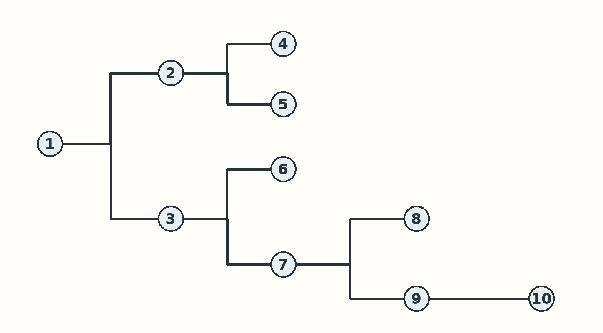

**Source PNG:** [`pencil_plates/vertebrate_phylogeny.png`](../app/src/main/assets/pencil_plates/vertebrate_phylogeny.png) · SHA-256: `376a255f8c67d250080b0b3eb86409b62f045e13a70fbdee0fbf0fe20a85d256`

**Creator:** Chordata QA project — original numbered schematic · **Rights statement:** CHORDATA project-original schematic; project-owner-authorised app distribution (no third-party reuse licence asserted)

**Source/provenance:** Project-original source, see registered manifest · Reference: https://openstax.org/books/biology-2e/pages/29-2-fishes

**Specific scientific review:** Check that clade branching represents modern relationships, not a ladder of evolutionary progress.

**Scientific review status:** PENDING · **Tamil editorial status:** PENDING

**Human reviewer evidence to enter in register:** precise anatomical observations and source checked; Tamil terms/semantic accuracy; any revision requests. Do not mark `ACCEPTED` without an actual reviewer identity and evidence.

### 11. Shark digestive system and spiral valve

**Tamil title:** சுறாவின் செரிமான மண்டலமும் சுருள் வால்வும்

**Lesson placement:** U2 — `u2-scoliodon`, page 2, section `digestive-system` · **Review priority:** HIGH — anatomy/safety

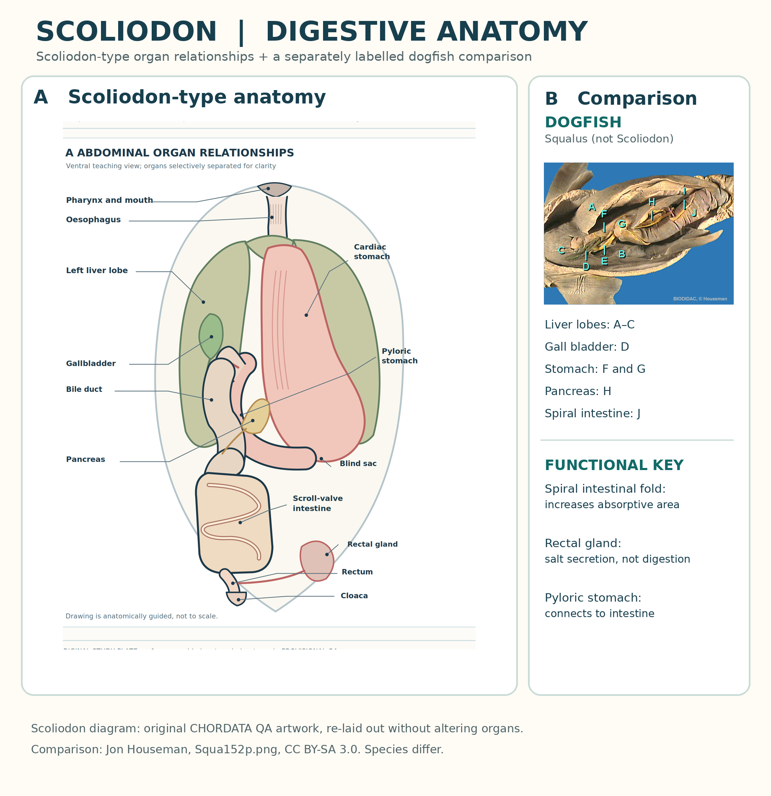

**Source PNG:** [`pencil_plates/scoliodon_digestive_en.png`](../app/src/main/assets/pencil_plates/scoliodon_digestive_en.png) · SHA-256: `195e816c3f80b1f6dfd494286549b83c7345911e006b5ec1540c4277869f3254`

**Creator:** CHORDATA original Scoliodon anatomy and Jon Houseman · **Rights statement:** CC BY-SA 3.0 Unported (attributed teaching composite)

**Source/provenance:** https://commons.wikimedia.org/wiki/File:Squa152p.png

**Specific scientific review:** Confirm stomach/duodenum/spiral-valve intestine, rectal gland and liver relationships against shark dissection references.

**Scientific review status:** PENDING · **Tamil editorial status:** PENDING

**Human reviewer evidence to enter in register:** precise anatomical observations and source checked; Tamil terms/semantic accuracy; any revision requests. Do not mark `ACCEPTED` without an actual reviewer identity and evidence.

### 13. Shark brain, dorsal view

**Tamil title:** சுறாவின் மூளை — மேற்புறத் தோற்றம்

**Lesson placement:** U2 — `u2-scoliodon`, page 4, section `brain` · **Review priority:** HIGH — anatomy/safety

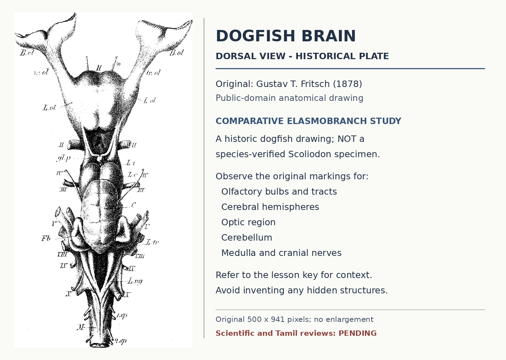

**Source PNG:** [`pencil_plates/shark_brain_dorsal_en.png`](../app/src/main/assets/pencil_plates/shark_brain_dorsal_en.png) · SHA-256: `8d61c1196f020158f865ee0434c66ac70323e3842d874d47dcf23a812f5da9ef`

**Creator:** Gustav Theodor Fritsch (1838-1927), historical dogfish brain plate (1878); CHORDATA QA contextual panel only · **Rights statement:** Public domain historical anatomical original (1878); independent QA typography panel

**Source/provenance:** https://commons.wikimedia.org/wiki/File:Fritsch_dogfish_shark_brain.png

**Specific scientific review:** Compare telencephalon, optic lobes and enlarged cerebellum with a shark dorsal-brain atlas; verify every leader line.

**Scientific review status:** PENDING · **Tamil editorial status:** PENDING

**Human reviewer evidence to enter in register:** precise anatomical observations and source checked; Tamil terms/semantic accuracy; any revision requests. Do not mark `ACCEPTED` without an actual reviewer identity and evidence.

### 14. Shark lateral line and sensory organs

**Tamil title:** சுறாவின் பக்கக்கோடும் உணர்வு உறுப்புகளும்

**Lesson placement:** U2 — `u2-scoliodon`, page 5, section `sense-organs` · **Review priority:** HIGH — anatomy/safety

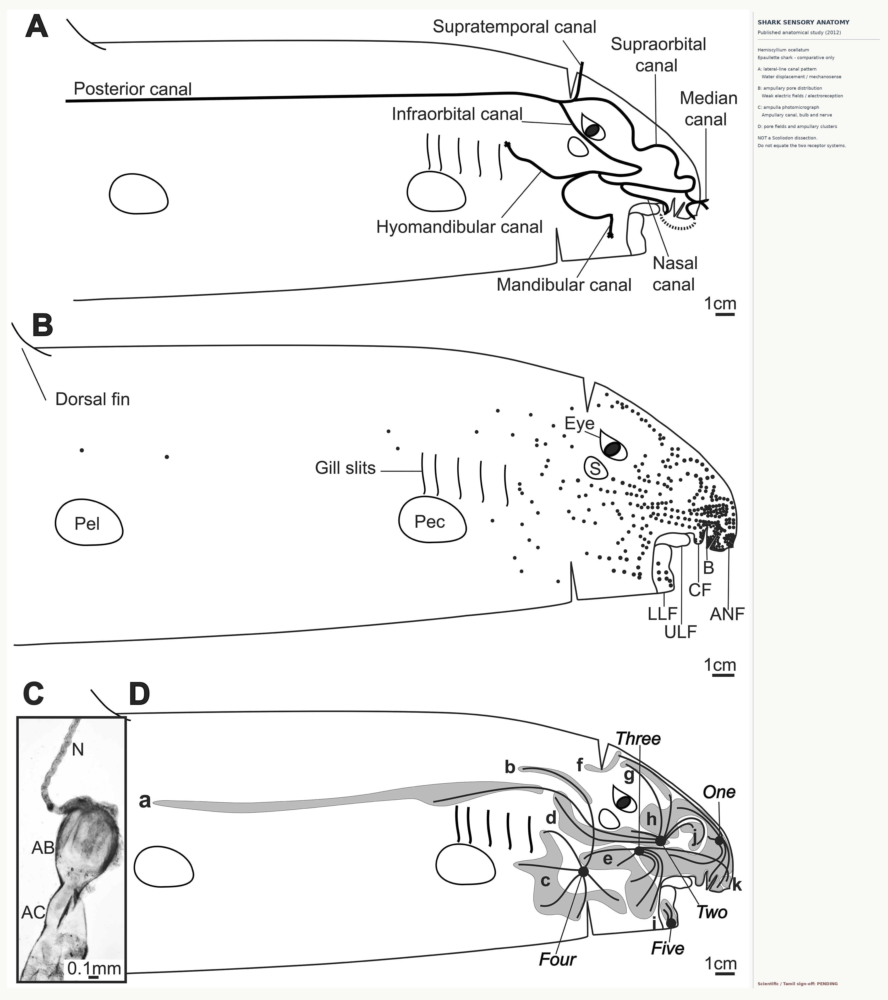

**Source PNG:** [`pencil_plates/shark_sensory_systems_en.png`](../app/src/main/assets/pencil_plates/shark_sensory_systems_en.png) · SHA-256: `f4772942d441d02589425580a46a312900bd5b6f141cd36f09a8657f0e6e6d91`

**Creator:** Marit Winther-Janson, Barbara E. Wueringer and Jamie E. Seymour (2012), PLOS ONE 7(11):e49857, original Fig. 2 · **Rights statement:** CC BY; 2012 PLOS ONE original research Figure 2, credited to Winther-Janson, Wueringer and Seymour

**Source/provenance:** https://pmc.ncbi.nlm.nih.gov/articles/PMC3511481/figure/pone-0049857-g002/

**Specific scientific review:** Verify ampullae of Lorenzini, lateral line and paired olfactory structures without inventing external openings.

**Scientific review status:** PENDING · **Tamil editorial status:** PENDING

**Human reviewer evidence to enter in register:** precise anatomical observations and source checked; Tamil terms/semantic accuracy; any revision requests. Do not mark `ACCEPTED` without an actual reviewer identity and evidence.

### 26. Frog respiration through skin and lungs

**Tamil title:** தவளையின் தோல் மற்றும் நுரையீரல் சுவாசம்

**Lesson placement:** U3 — `u3-rana`, page 3, section `respiratory-system` · **Review priority:** HIGH — anatomy/safety

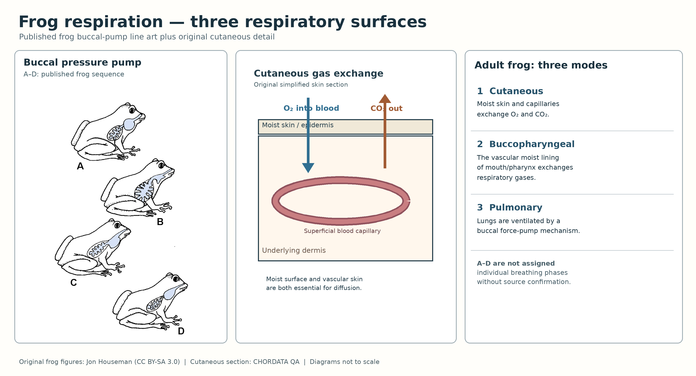

**Source PNG:** [`pencil_plates/rana_respiration_en.png`](../app/src/main/assets/pencil_plates/rana_respiration_en.png) · SHA-256: `99c7af022ef4ba7b00402f2eeb74e73f35de2771b5cc5babe2a344492c566804`

**Creator:** Jon Houseman (frog buccal-pump sequence); CHORDATA QA (cutaneous section and layout) · **Rights statement:** CC BY-SA 3.0 Unported — adapted composite; source credited

**Source/provenance:** https://commons.wikimedia.org/wiki/File:Amph001B.png

**Specific scientific review:** Distinguish cutaneous, buccopharyngeal and pulmonary respiration; check airflow depiction.

**Scientific review status:** PENDING · **Tamil editorial status:** PENDING

**Human reviewer evidence to enter in register:** precise anatomical observations and source checked; Tamil terms/semantic accuracy; any revision requests. Do not mark `ACCEPTED` without an actual reviewer identity and evidence.

### 27. Frog arterial system and major arches

**Tamil title:** தவளையின் தமனி மண்டலமும் முக்கிய தமனி வளைவுகளும்

**Lesson placement:** U3 — `u3-rana`, page 4, section `arterial-system` · **Review priority:** HIGH — anatomy/safety

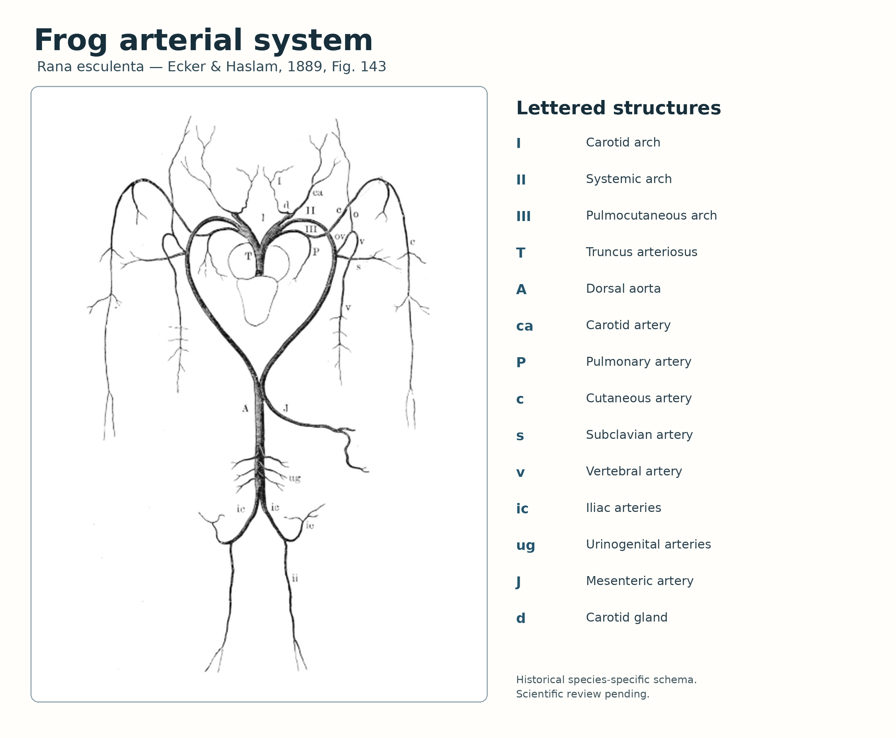

**Source PNG:** [`pencil_plates/frog_arterial_system_en.png`](../app/src/main/assets/pencil_plates/frog_arterial_system_en.png) · SHA-256: `899fdfb9b260a20998ec8203e422685e9b42755ce9c94aba74b6106cd4cbb7ed`

**Creator:** Alexander Ecker, The Anatomy of the Frog (1889), English trans. George Haslam; CHORDATA QA (layout) · **Rights statement:** Public domain — illustrated zoological text published 1889

**Source/provenance:** https://www.gutenberg.org/cache/epub/77560/pg77560-images.html

**Specific scientific review:** Verify carotid, systemic and pulmocutaneous arches; ensure systemic-arch continuity and heart-chamber labels.

**Scientific review status:** PENDING · **Tamil editorial status:** PENDING

**Human reviewer evidence to enter in register:** precise anatomical observations and source checked; Tamil terms/semantic accuracy; any revision requests. Do not mark `ACCEPTED` without an actual reviewer identity and evidence.

### 28. Frog brain, dorsal view

**Tamil title:** தவளையின் மூளை — மேற்புறத் தோற்றம்

**Lesson placement:** U3 — `u3-rana`, page 5, section `brain` · **Review priority:** HIGH — anatomy/safety

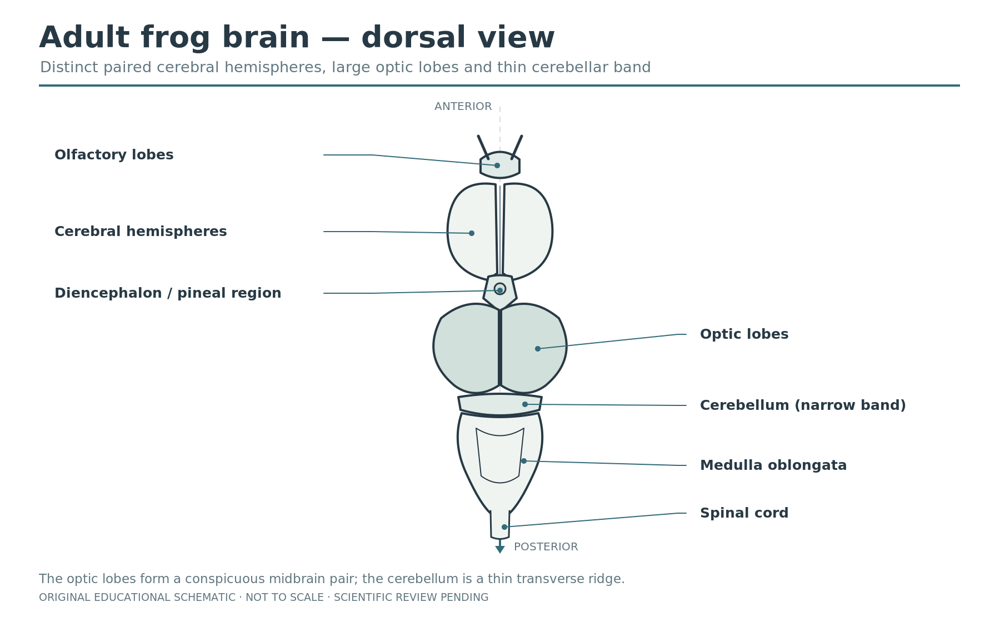

**Source PNG:** [`pencil_plates/frog_brain_dorsal_en.png`](../app/src/main/assets/pencil_plates/frog_brain_dorsal_en.png) · SHA-256: `444c7eefc643da3fe411eca4965b48fdbd76667ec9be41e2e742ce2bcb7e0b68`

**Creator:** The biology of the frog, S. J. Holmes (1927), fig. 101 (after Newman and Parker & Parker); CHORDATA QA (layout) · **Rights statement:** Public domain (1927 U.S. publication; Holmes died 1964)

**Source/provenance:** https://commons.wikimedia.org/wiki/File:The_biology_of_the_frog_(1927)_(20356465586).jpg

**Specific scientific review:** Check adult frog paired optic lobes, olfactory tracts, narrow cerebellum and medulla in dorsal view.

**Scientific review status:** PENDING · **Tamil editorial status:** PENDING

**Human reviewer evidence to enter in register:** precise anatomical observations and source checked; Tamil terms/semantic accuracy; any revision requests. Do not mark `ACCEPTED` without an actual reviewer identity and evidence.

### 36. Calotes heart and great arteries

**Tamil title:** தோட்டப் பல்லியின் இதயமும் பெருந்தமனிகளும்

**Lesson placement:** U4 — `u4-calotes`, page 4, section `arterial-system` · **Review priority:** HIGH — anatomy/safety

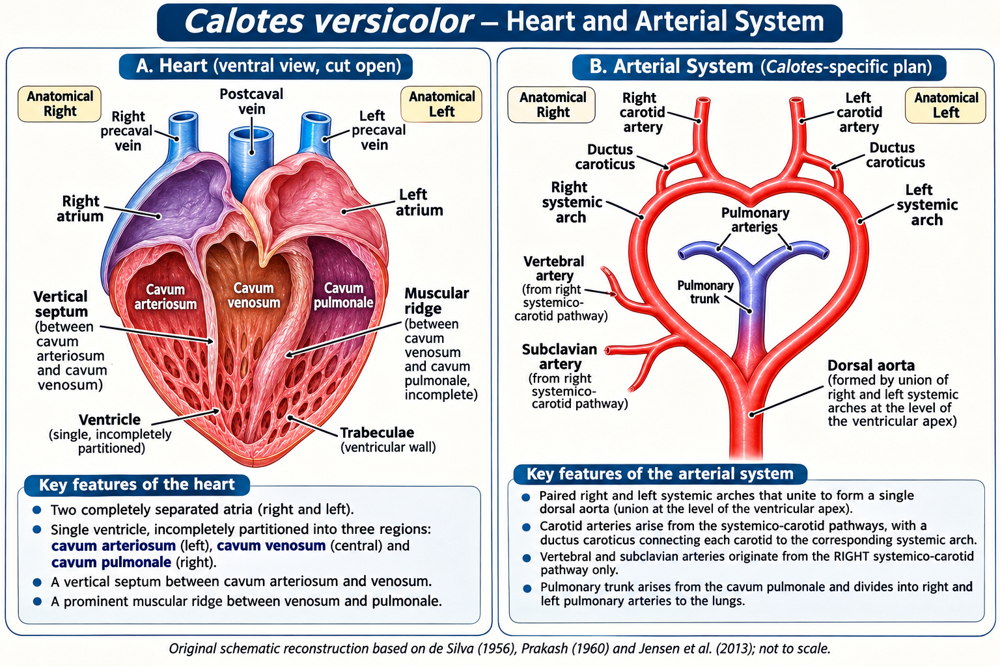

**Source PNG:** [`pencil_plates/calotes_heart_arteries_en.png`](../app/src/main/assets/pencil_plates/calotes_heart_arteries_en.png) · SHA-256: `937660abab533455b91cf1e0935c12d635f6df20fef63750d62e65efafbc1b7e`

**Creator:** CHORDATA project — original functional circulation schematic · **Rights statement:** Original CHORDATA teaching artwork

**Source/provenance:** Project-original source, see registered manifest

**Specific scientific review:** Check lizard aortic arches and ventricular partitioning; do not present the lizard heart as a mammalian four-chambered heart.

**Scientific review status:** PENDING · **Tamil editorial status:** PENDING

**Human reviewer evidence to enter in register:** precise anatomical observations and source checked; Tamil terms/semantic accuracy; any revision requests. Do not mark `ACCEPTED` without an actual reviewer identity and evidence.

### 37. Calotes brain

**Tamil title:** ஓணானின் மூளை

**Lesson placement:** U4 — `u4-calotes`, page 5, section `brain` · **Review priority:** HIGH — anatomy/safety

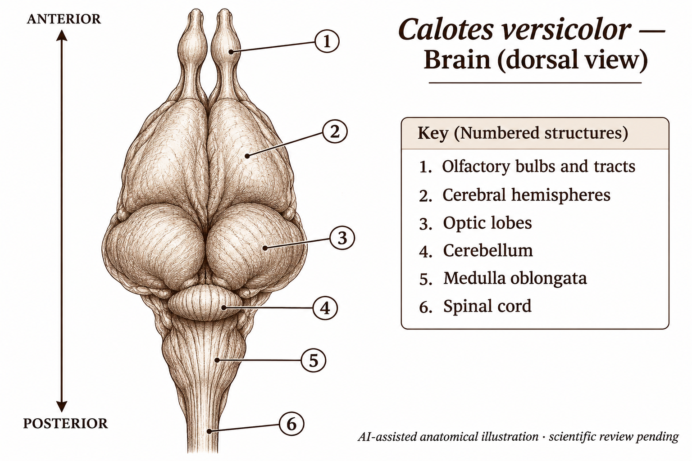

**Source PNG:** [`pencil_plates/calotes_brain_dorsal_en.png`](../app/src/main/assets/pencil_plates/calotes_brain_dorsal_en.png) · SHA-256: `a9d3136b213c96e62bc5cb45742474b325d9dbb8185502ed7e24bb1a4f3c3030`

**Creator:** OpenAI ChatGPT image generation — AI-assisted original QA illustration · **Rights statement:** AI-generated provisional artwork; no third-party illustration reproduced; academic review required

**Source/provenance:** Project-original source, see registered manifest

**Specific scientific review:** Verify reptilian cerebral hemispheres, optic lobes, diencephalon and cerebellar contour against Calotes anatomy.

**Scientific review status:** PENDING · **Tamil editorial status:** PENDING

**Human reviewer evidence to enter in register:** precise anatomical observations and source checked; Tamil terms/semantic accuracy; any revision requests. Do not mark `ACCEPTED` without an actual reviewer identity and evidence.

### 38. Amniote phylogeny and reptilian origins

**Tamil title:** அம்னியோட்டுகளின் பரிணாம மரமும் ஊர்வனவற்றின் தோற்றமும்

**Lesson placement:** U4 — `u4-origin-extinct`, page 1, section `origin-of-amniotes` · **Review priority:** HIGH — anatomy/safety

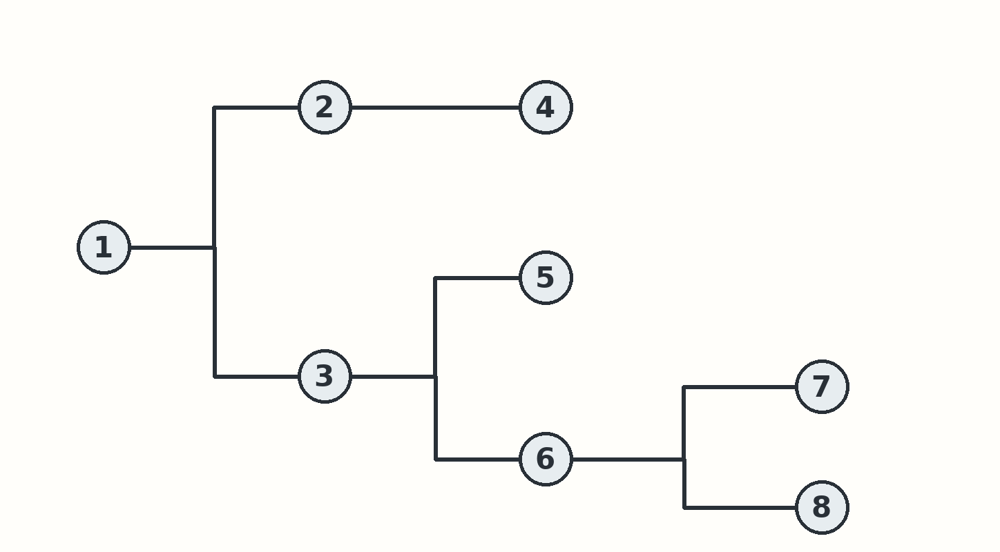

**Source PNG:** [`pencil_plates/amniote_phylogeny.png`](../app/src/main/assets/pencil_plates/amniote_phylogeny.png) · SHA-256: `30e155bfc27e6e847c22576ec120905b41cf8986eae0ddf993dbeb4ebf131813`

**Creator:** Chordata QA project — original numbered schematic · **Rights statement:** CHORDATA project-original schematic; project-owner-authorised app distribution (no third-party reuse licence asserted)

**Source/provenance:** Project-original source, see registered manifest · Reference: https://openstax.org/books/biology-2e/pages/29-4-reptiles

**Specific scientific review:** Check amniote branching and avoid presenting paraphyletic traditional reptile groups as modern clades.

**Scientific review status:** PENDING · **Tamil editorial status:** PENDING

**Human reviewer evidence to enter in register:** precise anatomical observations and source checked; Tamil terms/semantic accuracy; any revision requests. Do not mark `ACCEPTED` without an actual reviewer identity and evidence.

### 40. Important venomous snakes of India

**Tamil title:** இந்தியாவில் முக்கியமான விஷப்பாம்புகள்

**Lesson placement:** U4 — `u4-snakes-india`, page 2, section `big-four` · **Review priority:** HIGH — anatomy/safety

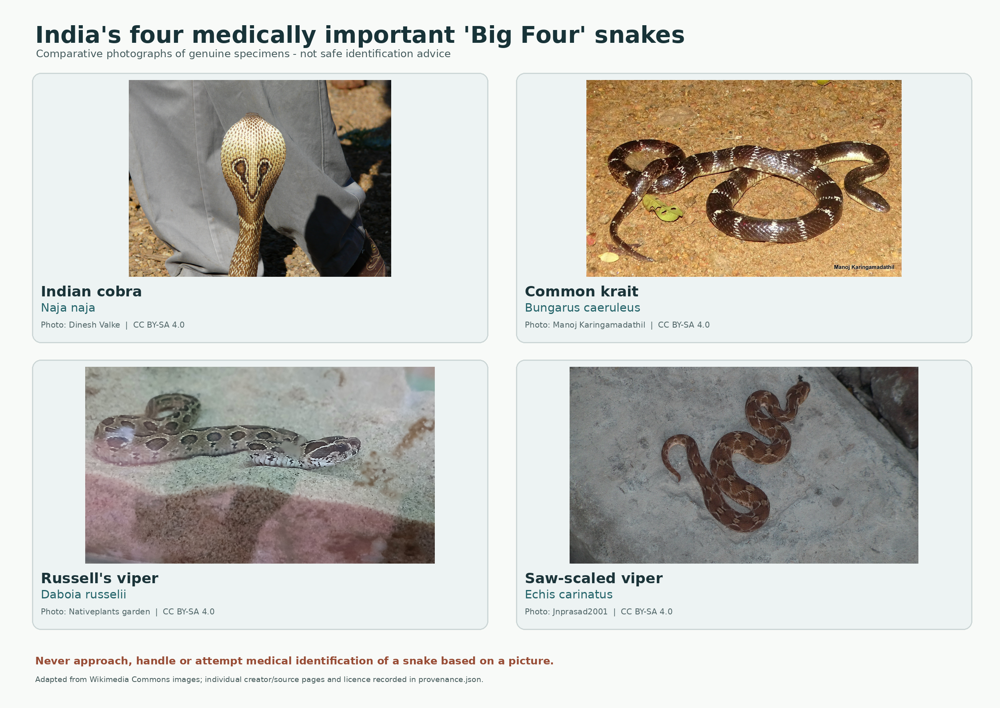

**Source PNG:** [`pencil_plates/india_big_four_snakes_en.png`](../app/src/main/assets/pencil_plates/india_big_four_snakes_en.png) · SHA-256: `60e62f263f46f4a475ad2ed91fc729d3c0c7f2e7eafc3a448e2c9b5cab048705`

**Creator:** Dinesh Valke; Manoj Karingamadathil; Nativeplants garden; Jnprasad2001; CHORDATA QA (educational presentation) · **Rights statement:** CC BY-SA 4.0 — derivative layout credited to all source creators

**Source/provenance:** https://commons.wikimedia.org/wiki/File:Naja_naja_113856920.jpg

**Specific scientific review:** Check identification characteristics against Indian taxa; caution that appearance is not reliable for treating suspected bites.

**Scientific review status:** PENDING · **Tamil editorial status:** PENDING

**Human reviewer evidence to enter in register:** precise anatomical observations and source checked; Tamil terms/semantic accuracy; any revision requests. Do not mark `ACCEPTED` without an actual reviewer identity and evidence.

### 42. Evidence-based snakebite first-aid flowchart

**Tamil title:** பாம்புக்கடிக்கான அறிவியல்பூர்வ முதலுதவி விளக்கப்படம்

**Lesson placement:** U4 — `u4-poison-apparatus`, page 3, section `evidence-based-first-aid` · **Review priority:** HIGH — anatomy/safety

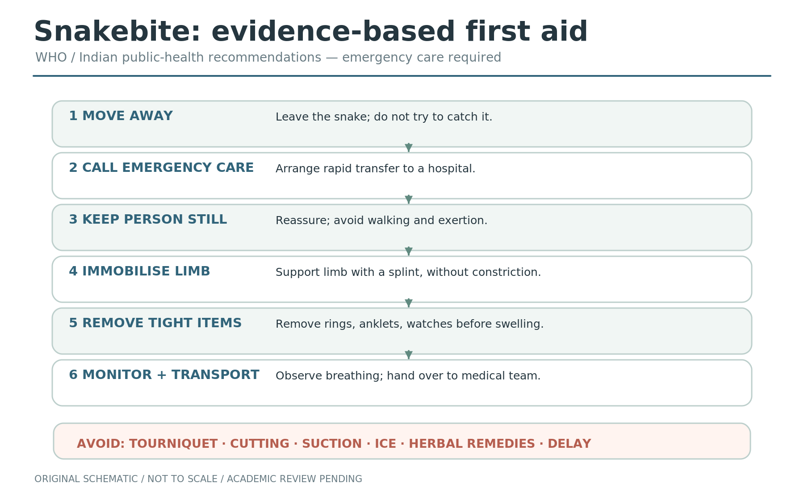

**Source PNG:** [`pencil_plates/snakebite_first_aid_en.png`](../app/src/main/assets/pencil_plates/snakebite_first_aid_en.png) · SHA-256: `1ace57d4694bace1b0da1e5f41b2693a99bb50429f7699f18e4a3377debf52a7`

**Creator:** CHORDATA QA — original vector anatomical schematic · **Rights statement:** Original project illustration; no source images copied

**Source/provenance:** Project-original source, see registered manifest

**Specific scientific review:** Review wording against current WHO and Indian snakebite guidance; reject tourniquets, cutting, suction and treatment delay.

**Scientific review status:** PENDING · **Tamil editorial status:** PENDING

**Human reviewer evidence to enter in register:** precise anatomical observations and source checked; Tamil terms/semantic accuracy; any revision requests. Do not mark `ACCEPTED` without an actual reviewer identity and evidence.

### 47. Male and female pigeon urinogenital systems

**Tamil title:** ஆண் மற்றும் பெண் புறாக்களின் சிறுநீர்–இனப்பெருக்க மண்டலங்கள்

**Lesson placement:** U5 — `u5-columba`, page 3, section `urinogenital-system` · **Review priority:** HIGH — anatomy/safety

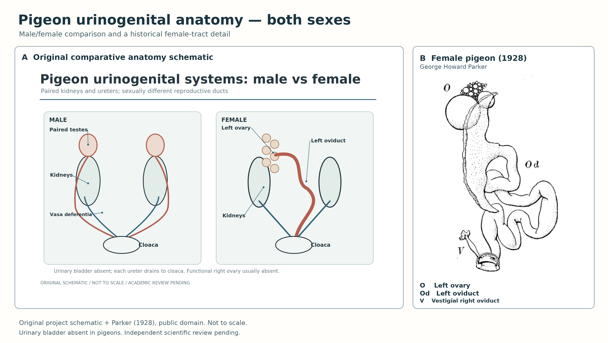

**Source PNG:** [`pencil_plates/pigeon_urinogenital_en.png`](../app/src/main/assets/pencil_plates/pigeon_urinogenital_en.png) · SHA-256: `f0678127364b73f72dff3a857aa61a0fae56715003c1805d86606ad679630404`

**Creator:** OpenAI ImageGen — owner-selected original CHORDATA educational plate (12 November 2026) · **Rights statement:** Original AI-assisted educational illustration supplied for CHORDATA QA; scientific review pending

**Source/provenance:** Project-original source, see registered manifest

**Specific scientific review:** Verify paired male testes, female functional left ovary/oviduct, ureter-to-cloaca relationship and absent urinary bladder.

**Scientific review status:** PENDING · **Tamil editorial status:** PENDING

**Human reviewer evidence to enter in register:** precise anatomical observations and source checked; Tamil terms/semantic accuracy; any revision requests. Do not mark `ACCEPTED` without an actual reviewer identity and evidence.

### 51. Bird lungs and air sacs

**Tamil title:** பறவைகளின் நுரையீரலும் காற்றுப்பைகளும்

**Lesson placement:** U5 — `u5-flight-adaptations`, page 3, section `respiration-metabolism` · **Review priority:** HIGH — anatomy/safety

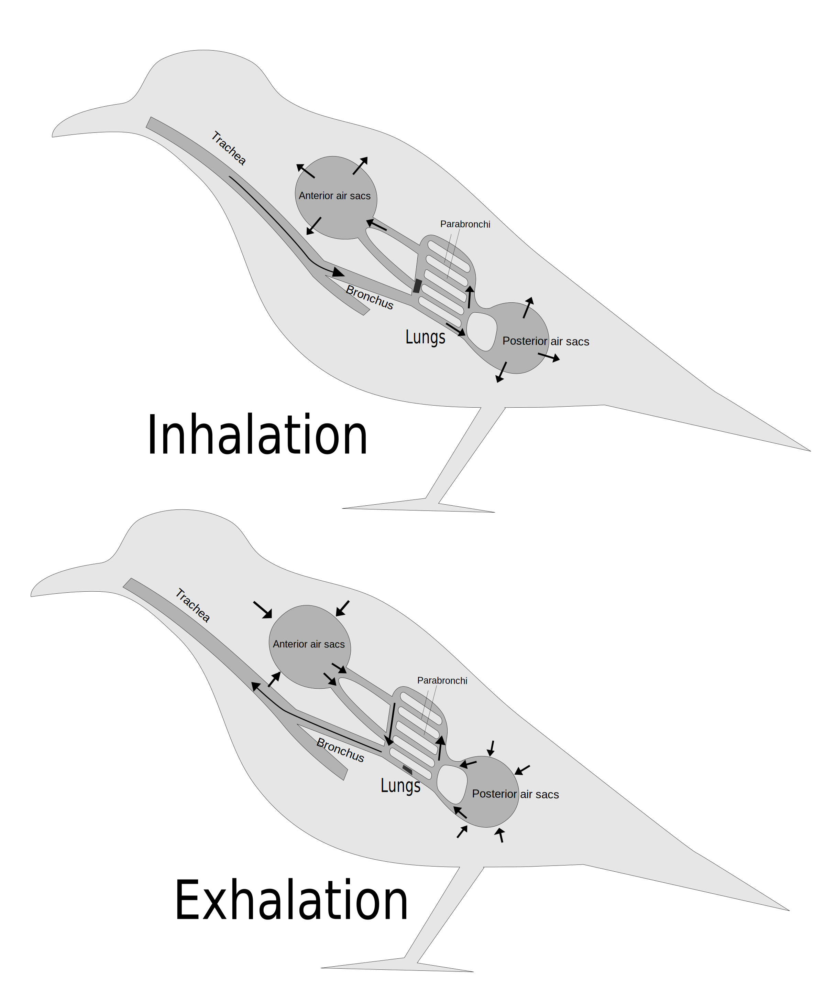

**Source PNG:** [`pencil_plates/avian_respiration_en.png`](../app/src/main/assets/pencil_plates/avian_respiration_en.png) · SHA-256: `c3d43b9dbdf71d41b173d2543f4c51495b699ed2d96c3d2667370672c8bbacb5`

**Creator:** L. Shyamal (2007; updated 2012), after R. McNeill Alexander; CHORDATA QA (raster rendering) · **Rights statement:** Public domain — dedicated by L. Shyamal

**Source/provenance:** https://commons.wikimedia.org/wiki/File:BirdRespiration.svg

**Specific scientific review:** Check posterior/anterior air-sac relationships, parabronchial airflow direction and breathing-cycle terminology.

**Scientific review status:** PENDING · **Tamil editorial status:** PENDING

**Additional TA variant:** [`pencil_plates/avian_respiration_ta.png`](../app/src/main/assets/pencil_plates/avian_respiration_ta.png) · SHA-256 `e29ead970da9fd42aa067bb810ec414fd0e63a78f84ab6e0ea19b4f4673bee40` · AI-generated original (ChatGPT ImageGen) · AI-generated for CHORDATA; project-owner-authorised app distribution (no exclusive copyright or third-party reuse licence asserted)

**Human reviewer evidence to enter in register:** precise anatomical observations and source checked; Tamil terms/semantic accuracy; any revision requests. Do not mark `ACCEPTED` without an actual reviewer identity and evidence.

### 52. Migratory flyways and stopovers

**Tamil title:** பறவை வலசைப் பாதைகளும் இடைத்தங்குமிடங்களும்

**Lesson placement:** U5 — `u5-bird-migration`, page 1, section `migration-patterns` · **Review priority:** HIGH — anatomy/safety

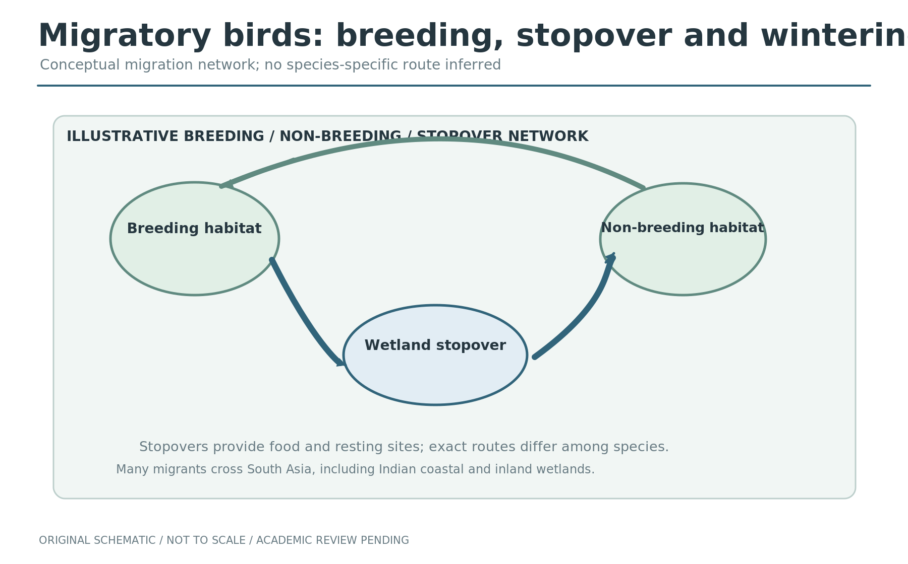

**Source PNG:** [`pencil_plates/bird_migration_stopovers_en.png`](../app/src/main/assets/pencil_plates/bird_migration_stopovers_en.png) · SHA-256: `bc124ea5859a9284988730a49c264489df4c065d3a5d07127057777a9cb79268`

**Creator:** CHORDATA QA — original vector anatomical schematic · **Rights statement:** Original project illustration; no source images copied

**Source/provenance:** Project-original source, see registered manifest

**Specific scientific review:** Confirm illustrative routes are not depicted as verified species-specific migrations.

**Scientific review status:** PENDING · **Tamil editorial status:** PENDING

**Human reviewer evidence to enter in register:** precise anatomical observations and source checked; Tamil terms/semantic accuracy; any revision requests. Do not mark `ACCEPTED` without an actual reviewer identity and evidence.

### 56. Rabbit kidneys and urinary passages

**Tamil title:** முயலின் சிறுநீரகங்களும் சிறுநீர்ப் பாதைகளும்

**Lesson placement:** U5 — `u5-rabbit`, page 3, section `excretory-system` · **Review priority:** HIGH — anatomy/safety

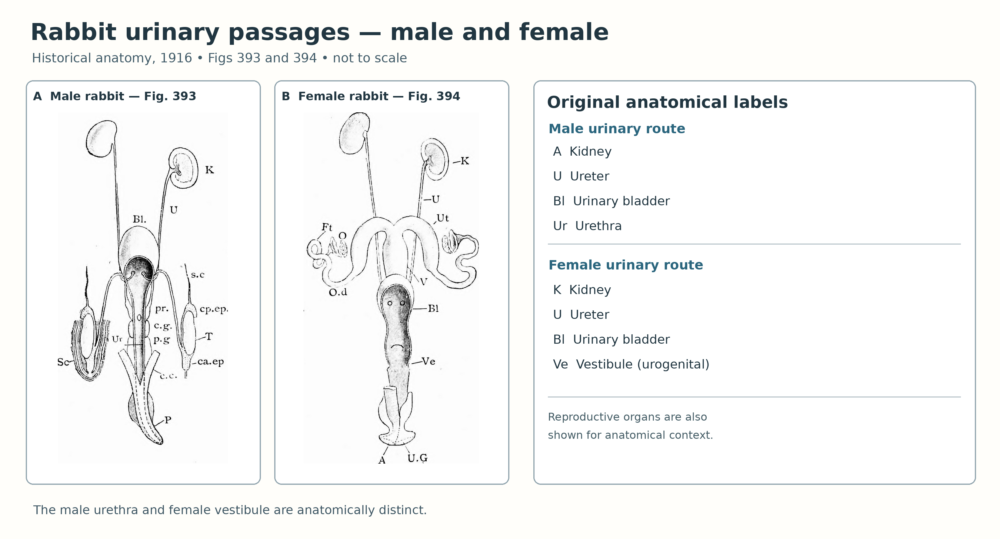

**Source PNG:** [`pencil_plates/rabbit_urinary_tract.png`](../app/src/main/assets/pencil_plates/rabbit_urinary_tract.png) · SHA-256: `7abf4f2b443086b9e323e0f32080da9be71e0eb1449416279ab5bde475430d6b`

**Creator:** J. Arthur Thomson, Outlines of Zoology (1916), Figs 393/394; original illustrator unidentified; CHORDATA QA layout · **Rights statement:** Public domain — J. Arthur Thomson (died 1933), published 1916

**Source/provenance:** https://commons.wikimedia.org/wiki/File:Image_from_page_743_of_%22Outlines_of_zoology%22_(1916)_(14597351000).jpg · Reference: https://www.sunankalijaga.org/prosiding/index.php/icse/article/view/75

**Specific scientific review:** Verify kidney, ureter, urinary bladder and urethra; distinguish urinary from reproductive structures.

**Scientific review status:** PENDING · **Tamil editorial status:** PENDING

**Human reviewer evidence to enter in register:** precise anatomical observations and source checked; Tamil terms/semantic accuracy; any revision requests. Do not mark `ACCEPTED` without an actual reviewer identity and evidence.

### 57. Rabbit brain

**Tamil title:** முயலின் மூளை

**Lesson placement:** U5 — `u5-rabbit`, page 4, section `brain` · **Review priority:** HIGH — anatomy/safety

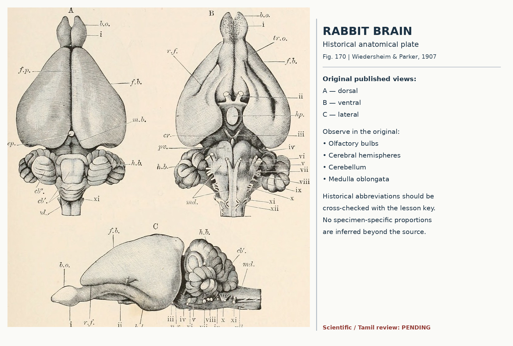

**Source PNG:** [`pencil_plates/rabbit_brain_en.png`](../app/src/main/assets/pencil_plates/rabbit_brain_en.png) · SHA-256: `d22d4ac27faddb7d40f67123d346f907970c8517539cfcb71313988f0d883a35`

**Creator:** Robert Wiedersheim (1848–1923) and William Newton Parker (1857–1923), Comparative Anatomy of Vertebrates (1907), fig. 170; Internet Archive Book Images scan · **Rights statement:** Original illustration published 1907, public domain; scan via Internet Archive Book Images (Flickr)

**Source/provenance:** https://www.flickr.com/photos/internetarchivebookimages/20481807000/

**Specific scientific review:** Check mammalian cerebral hemispheres, cerebellum, olfactory bulbs and brainstem in the stated view.

**Scientific review status:** PENDING · **Tamil editorial status:** PENDING

**Human reviewer evidence to enter in register:** precise anatomical observations and source checked; Tamil terms/semantic accuracy; any revision requests. Do not mark `ACCEPTED` without an actual reviewer identity and evidence.

### 63. Human and rabbit dental formulae

**Tamil title:** மனிதன் மற்றும் முயலின் பற்சூத்திரங்கள்

**Lesson placement:** U5 — `u5-dentition`, page 3, section `dental-formula` · **Review priority:** HIGH — anatomy/safety

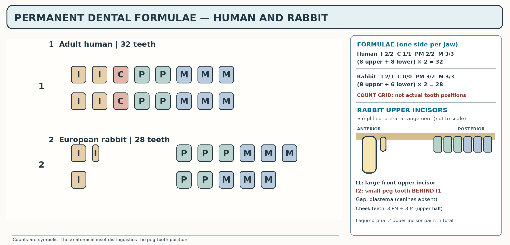

**Source PNG:** [`pencil_plates/human_rabbit_dental_formula.png`](../app/src/main/assets/pencil_plates/human_rabbit_dental_formula.png) · SHA-256: `29d0ac32251a09aedd446233d675dd8fd6a75122223ccdd206ca3132b9df1afc`

**Creator:** Chordata QA project — original numbered schematic · **Rights statement:** CHORDATA project-original schematic; project-owner-authorised app distribution (no third-party reuse licence asserted)

**Source/provenance:** Project-original source, see registered manifest · Reference: https://www.mspca.org/clinical/dental-anatomy-and-disease-of-the-domestic-rabbit-oryctolagus-cuniculus/

**Specific scientific review:** Check deciduous/permanent status and dental formula notation; distinguish human and rabbit counts.

**Scientific review status:** PENDING · **Tamil editorial status:** PENDING

**Human reviewer evidence to enter in register:** precise anatomical observations and source checked; Tamil terms/semantic accuracy; any revision requests. Do not mark `ACCEPTED` without an actual reviewer identity and evidence.

### 1. Deuterostome evolutionary relationships

**Tamil title:** டியூட்டரோஸ்டோம் குழுக்களின் பரிணாம உறவுகள்

**Lesson placement:** U1 — `u1-origin`, page 1, section `deuterostome-ancestry` · **Review priority:** STANDARD

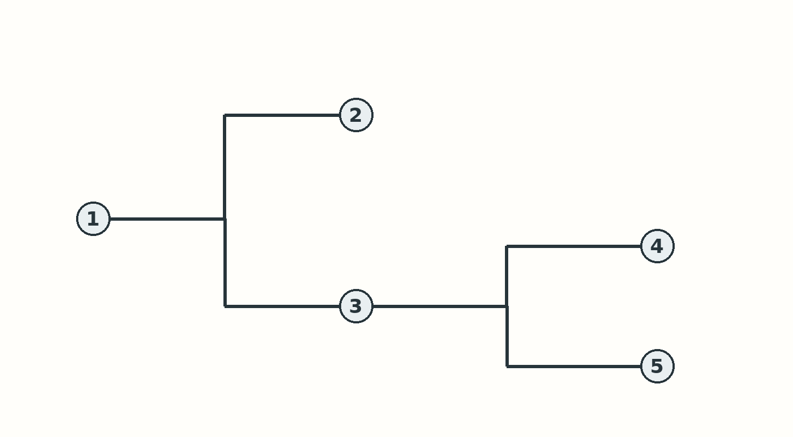

**Source PNG:** [`pencil_plates/deuterostome_relationships.png`](../app/src/main/assets/pencil_plates/deuterostome_relationships.png) · SHA-256: `ee710fdc11c2851ca3768a50143ce19cce78d9d352a32b381ed66b7c7155d410`

**Creator:** Chordata QA project — original numbered schematic · **Rights statement:** CHORDATA project-original schematic; project-owner-authorised app distribution (no third-party reuse licence asserted)

**Source/provenance:** Project-original source, see registered manifest · Reference: https://academic.oup.com/icb/article/64/5/1175/7727798

**Specific scientific review:** Check diagram morphology, arrows, labels, caption and age/taxon appropriateness.

**Scientific review status:** PENDING · **Tamil editorial status:** PENDING

**Human reviewer evidence to enter in register:** precise anatomical observations and source checked; Tamil terms/semantic accuracy; any revision requests. Do not mark `ACCEPTED` without an actual reviewer identity and evidence.

### 2. Five diagnostic chordate features

**Tamil title:** முதுகுநாணிகளின் ஐந்து அடிப்படைப் பண்புகள்

**Lesson placement:** U1 — `u1-general-characters`, page 1, section `diagnostic-features` · **Review priority:** STANDARD

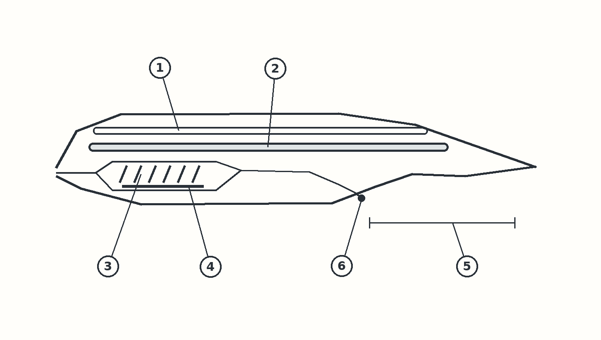

**Source PNG:** [`pencil_plates/chordate_features.png`](../app/src/main/assets/pencil_plates/chordate_features.png) · SHA-256: `8f0daae6d718061336c6d216c9a5b5ba5eaa0d30e62376c68dc7d286b2bbcaee`

**Creator:** Microvipera (generalised chordate morphology); CHORDATA QA (layout) · **Rights statement:** CC0 1.0 — original artwork dedicated to public domain

**Source/provenance:** https://commons.wikimedia.org/wiki/File:General_chordate_morphology.svg · Reference: https://openstax.org/books/biology-2e/pages/29-chapter-summary

**Specific scientific review:** Check diagram morphology, arrows, labels, caption and age/taxon appropriateness.

**Scientific review status:** PENDING · **Tamil editorial status:** PENDING

**Human reviewer evidence to enter in register:** precise anatomical observations and source checked; Tamil terms/semantic accuracy; any revision requests. Do not mark `ACCEPTED` without an actual reviewer identity and evidence.

### 3. Balanoglossus external morphology

**Tamil title:** பாலனோகிளாசஸின் புறத்தோற்றம்

**Lesson placement:** U1 — `u1-hemichordata`, page 1, section `body-plan` · **Review priority:** STANDARD

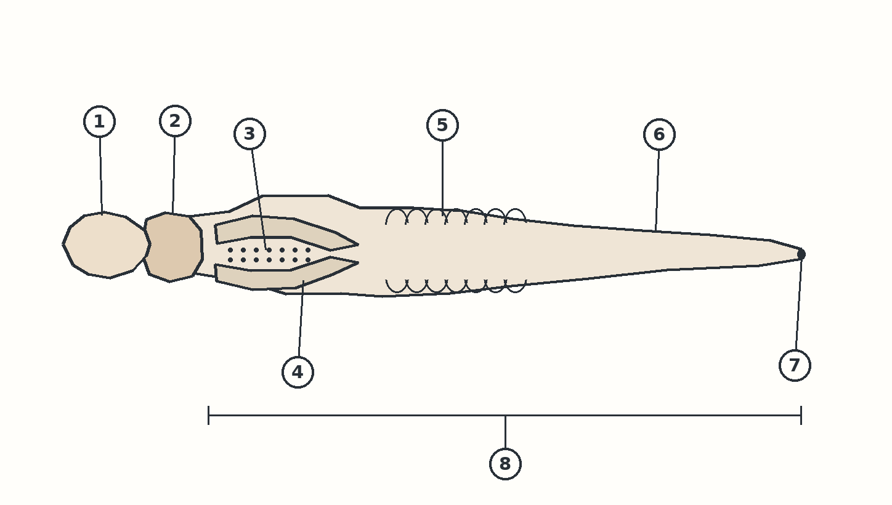

**Source PNG:** [`pencil_plates/balanoglossus_external.png`](../app/src/main/assets/pencil_plates/balanoglossus_external.png) · SHA-256: `fd237c4155fd2a1eb261ddb0d3c8d7de9b2cb00c5b2dd92d27054dda818f2741`

**Creator:** Unknown illustrator, New International Encyclopaedia (1905); CHORDATA QA (layout) · **Rights statement:** Public domain — New International Encyclopaedia, 1905

**Source/provenance:** https://commons.wikimedia.org/wiki/File:NIE_1905_Ascidians_and_balanoglossus.png · Reference: https://mlsu.ac.in/econtents/4190_practical-zoology-invertebrate.pdf

**Specific scientific review:** Check diagram morphology, arrows, labels, caption and age/taxon appropriateness.

**Scientific review status:** PENDING · **Tamil editorial status:** PENDING

**Human reviewer evidence to enter in register:** precise anatomical observations and source checked; Tamil terms/semantic accuracy; any revision requests. Do not mark `ACCEPTED` without an actual reviewer identity and evidence.

### 4. Ascidian larva, adult and metamorphosis

**Tamil title:** அசிடியன் இளர்வி, முதிர்நிலை மற்றும் உருமாற்றம்

**Lesson placement:** U1 — `u1-urochordata`, page 3, section `retrogressive-metamorphosis` · **Review priority:** STANDARD

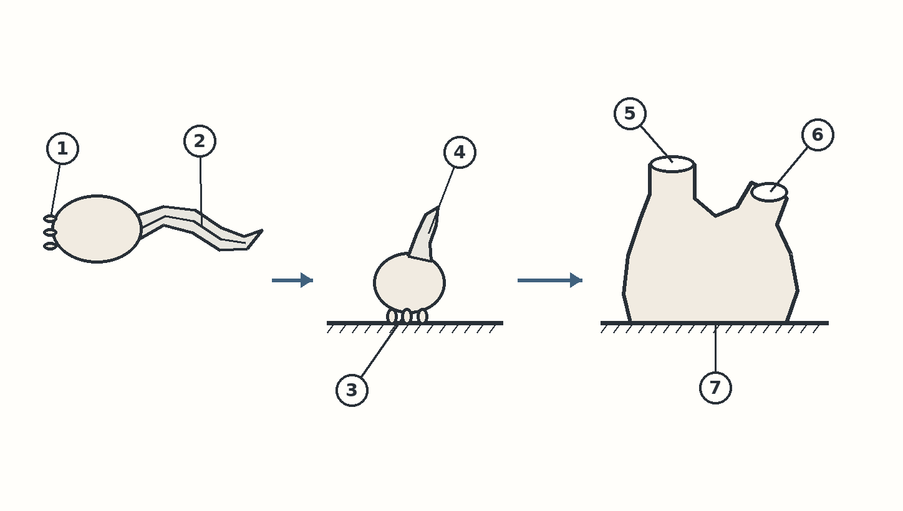

**Source PNG:** [`pencil_plates/ascidia_metamorphosis.png`](../app/src/main/assets/pencil_plates/ascidia_metamorphosis.png) · SHA-256: `af4f986941cd3b9f65452bde00ef6974e2ce425c01e2d7a988f44986f01dfa00`

**Creator:** Unknown illustrator, The New International Encyclopaedia (1905), Vol. 2; historical plate · **Rights statement:** Public domain historical encyclopaedia illustration (published 1905); exact original scan

**Source/provenance:** https://commons.wikimedia.org/wiki/File:NIE_1905_Ascidians_and_balanoglossus.png · Reference: https://en.wikisource.org/wiki/The_New_International_Encyclop%C3%A6dia/Ascidian

**Specific scientific review:** Check diagram morphology, arrows, labels, caption and age/taxon appropriateness.

**Scientific review status:** PENDING · **Tamil editorial status:** PENDING

**Human reviewer evidence to enter in register:** precise anatomical observations and source checked; Tamil terms/semantic accuracy; any revision requests. Do not mark `ACCEPTED` without an actual reviewer identity and evidence.

### 5. Branchiostoma external anatomy

**Tamil title:** பிராங்கியோஸ்டோமாவின் புற அமைப்பு

**Lesson placement:** U1 — `u1-cephalochordata`, page 1, section `external-anatomy` · **Review priority:** STANDARD

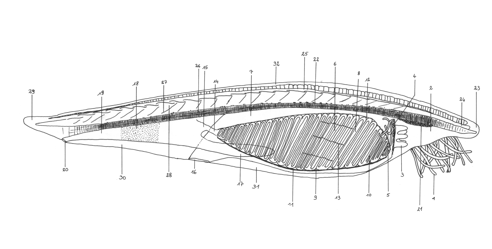

**Source PNG:** [`pencil_plates/branchiostoma_en.png`](../app/src/main/assets/pencil_plates/branchiostoma_en.png) · SHA-256: `68acc2123fa7f57c1eb82feba7bbc1d81f40faf9fc14c12f813be618845726e0`

**Creator:** Hans Hillewaert — original 32-label Branchiostoma lanceolatum drawing · **Rights statement:** CC BY-SA 4.0 (drawing and PNG adaptation)

**Source/provenance:** https://commons.wikimedia.org/wiki/File:Branchiostoma_anatomy.jpg

**Specific scientific review:** Check diagram morphology, arrows, labels, caption and age/taxon appropriateness.

**Scientific review status:** PENDING · **Tamil editorial status:** PENDING

**Additional TA variant:** [`pencil_plates/branchiostoma_ta.png`](../app/src/main/assets/pencil_plates/branchiostoma_ta.png) · SHA-256 `2fbd48be62b83309c87214492ea20dfea1995a3e624fca66c17ed995c95d9b1e` · OpenAI ChatGPT ImageGen — original anatomical reconstruction, digitally labelled (2026-11-08) · Original AI-generated illustration; no third-party illustration copied

**Human reviewer evidence to enter in register:** precise anatomical observations and source checked; Tamil terms/semantic accuracy; any revision requests. Do not mark `ACCEPTED` without an actual reviewer identity and evidence.

### 6. Representative vertebrate body plan

**Tamil title:** முதுகெலும்பிகளின் பொது உடலமைப்பு

**Lesson placement:** U1 — `u1-vertebrata-characters`, page 2, section `organ-systems` · **Review priority:** STANDARD

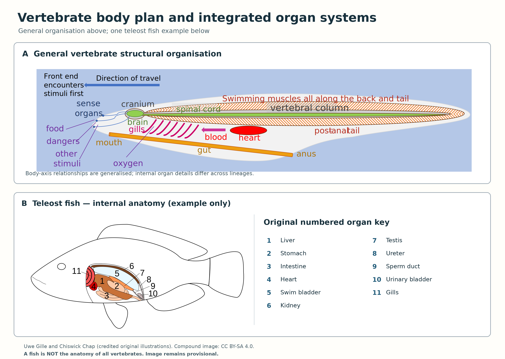

**Source PNG:** [`pencil_plates/vertebrate_organs_en.png`](../app/src/main/assets/pencil_plates/vertebrate_organs_en.png) · SHA-256: `f828c226f6d99ab9558f783a61af6e39a35e5205eda569edeace062d2478633b`

**Creator:** Chiswick Chap (vertebrate body plan); Uwe Gille (teleost organs); CHORDATA QA (layout) · **Rights statement:** CC BY-SA 4.0 — composite derivative, both original artists credited

**Source/provenance:** https://commons.wikimedia.org/wiki/File:Vertebrate_body_plan.svg

**Specific scientific review:** Check diagram morphology, arrows, labels, caption and age/taxon appropriateness.

**Scientific review status:** PENDING · **Tamil editorial status:** PENDING

**Human reviewer evidence to enter in register:** precise anatomical observations and source checked; Tamil terms/semantic accuracy; any revision requests. Do not mark `ACCEPTED` without an actual reviewer identity and evidence.

### 8. Adult lamprey and ammocoetes larva

**Tamil title:** முதிர்ந்த லாம்ப்ரே மீனும் அமோகோசீட்ஸ் இளர்வியும்

**Lesson placement:** U1 — `u1-agnatha`, page 2, section `ammocoetes` · **Review priority:** STANDARD

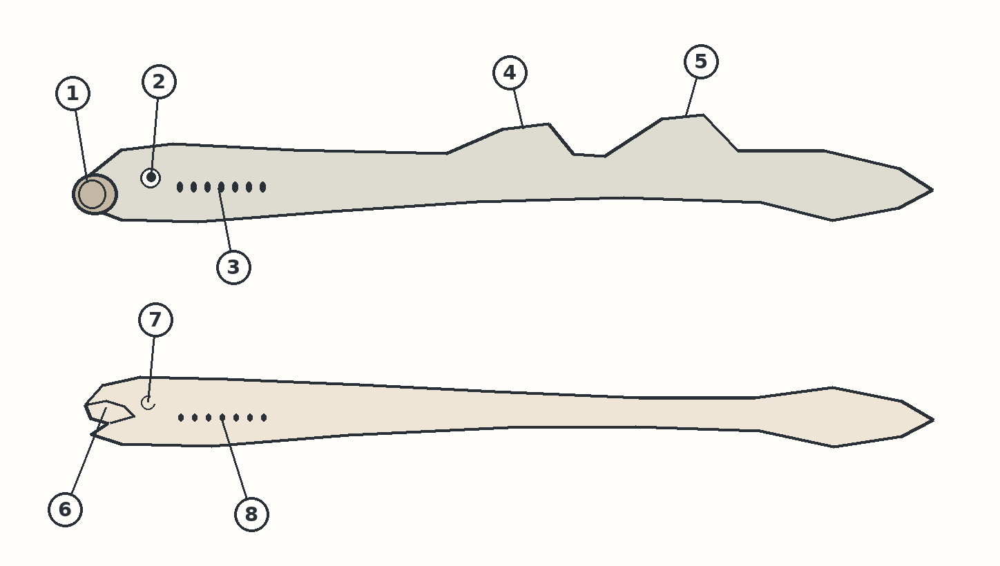

**Source PNG:** [`pencil_plates/lamprey_adult_ammocoete.png`](../app/src/main/assets/pencil_plates/lamprey_adult_ammocoete.png) · SHA-256: `d833b1aec9541f1c8649f460ebf3829da3a478e0d7b942794b591a190e5fb48f`

**Creator:** LadyofHats (adult); H. G. Seeley, 1886 (larva); CHORDATA QA (layout) · **Rights statement:** Public domain: LadyofHats dedication; Seeley 1886 / UW Image Bank

**Source/provenance:** https://commons.wikimedia.org/wiki/File:Lamprey_anatomy.png · Reference: https://publications.naturalengland.org.uk/file/112006

**Specific scientific review:** Check diagram morphology, arrows, labels, caption and age/taxon appropriateness.

**Scientific review status:** PENDING · **Tamil editorial status:** PENDING

**Human reviewer evidence to enter in register:** precise anatomical observations and source checked; Tamil terms/semantic accuracy; any revision requests. Do not mark `ACCEPTED` without an actual reviewer identity and evidence.

### 9. Major living fish groups

**Tamil title:** மீன்களின் முக்கிய வகைப்பாட்டுக் குழுக்கள்

**Lesson placement:** U2 — `u2-pisces-classification`, page 2, section `major-groups` · **Review priority:** STANDARD

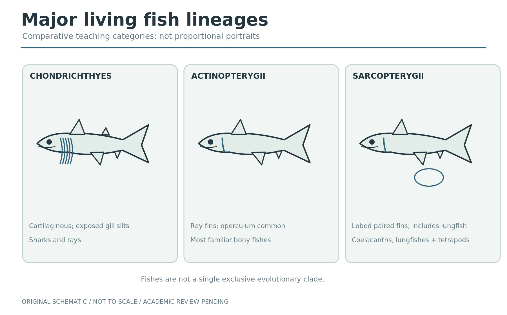

**Source PNG:** [`pencil_plates/fish_major_groups_en.png`](../app/src/main/assets/pencil_plates/fish_major_groups_en.png) · SHA-256: `54617d2619e40baac973441d064c123a6b63ceb9d39ff7a743dd70ecb42bfef5`

**Creator:** OpenAI ImageGen — owner-selected original CHORDATA educational plate (12 November 2026) · **Rights statement:** Original AI-assisted educational illustration supplied for CHORDATA QA; scientific review pending

**Source/provenance:** Project-original source, see registered manifest

**Specific scientific review:** Check diagram morphology, arrows, labels, caption and age/taxon appropriateness.

**Scientific review status:** PENDING · **Tamil editorial status:** PENDING

**Human reviewer evidence to enter in register:** precise anatomical observations and source checked; Tamil terms/semantic accuracy; any revision requests. Do not mark `ACCEPTED` without an actual reviewer identity and evidence.

### 10. Comparative milk shark (Rhizoprionodon acutus), NOT Scoliodon — external features and fins

**Tamil title:** ஒப்பீட்டுப் படம்: பால் சுறா (Rhizoprionodon acutus); ஸ்கோலியோடான் (Scoliodon) அல்ல — புறத்தோற்றம் மற்றும் துடுப்புகள்

**Lesson placement:** U2 — `u2-scoliodon`, page 1, section `external-features` · **Review priority:** STANDARD

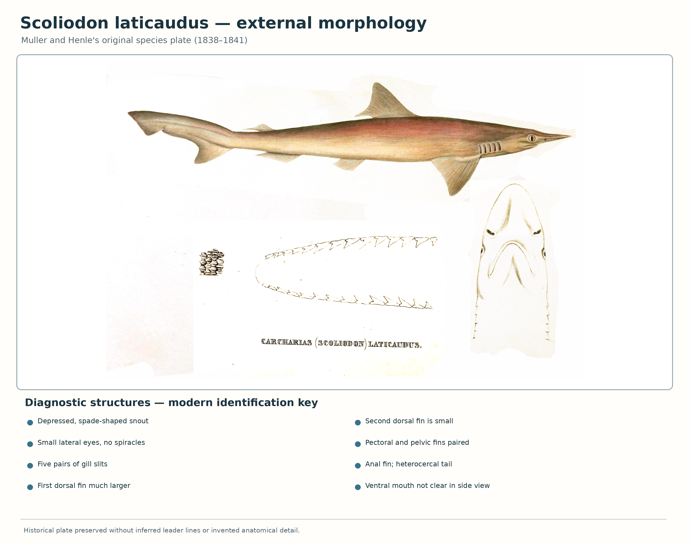

**Source PNG:** [`pencil_plates/scoliodon_external_anatomy_en.png`](../app/src/main/assets/pencil_plates/scoliodon_external_anatomy_en.png) · SHA-256: `f422a6fedf39b78c3c262eef521242b65e5a7c6c68b5e25869e557c33bfe48f7`

**Creator:** Eduard Rüppell (1837) — historical plate; Field Museum Library/BHL scan; CHORDATA QA crop/layout · **Rights statement:** Public domain — Rüppell 1837; faithful historical scan

**Source/provenance:** https://commons.wikimedia.org/wiki/File:Neue_Wirbelthiere_zu_der_Fauna_von_Abyssinien_geh%C3%B6rig_(Taf._18_Fig.1-4)_BHL37140507.jpg

**Specific scientific review:** Check diagram morphology, arrows, labels, caption and age/taxon appropriateness.

**Scientific review status:** PENDING · **Tamil editorial status:** PENDING

**Human reviewer evidence to enter in register:** precise anatomical observations and source checked; Tamil terms/semantic accuracy; any revision requests. Do not mark `ACCEPTED` without an actual reviewer identity and evidence.

### 12. Shark gills and respiratory lamellae

**Tamil title:** சுறாவின் செவுள்களும் சுவாசத் தகடுகளும்

**Lesson placement:** U2 — `u2-scoliodon`, page 3, section `respiratory-system` · **Review priority:** STANDARD

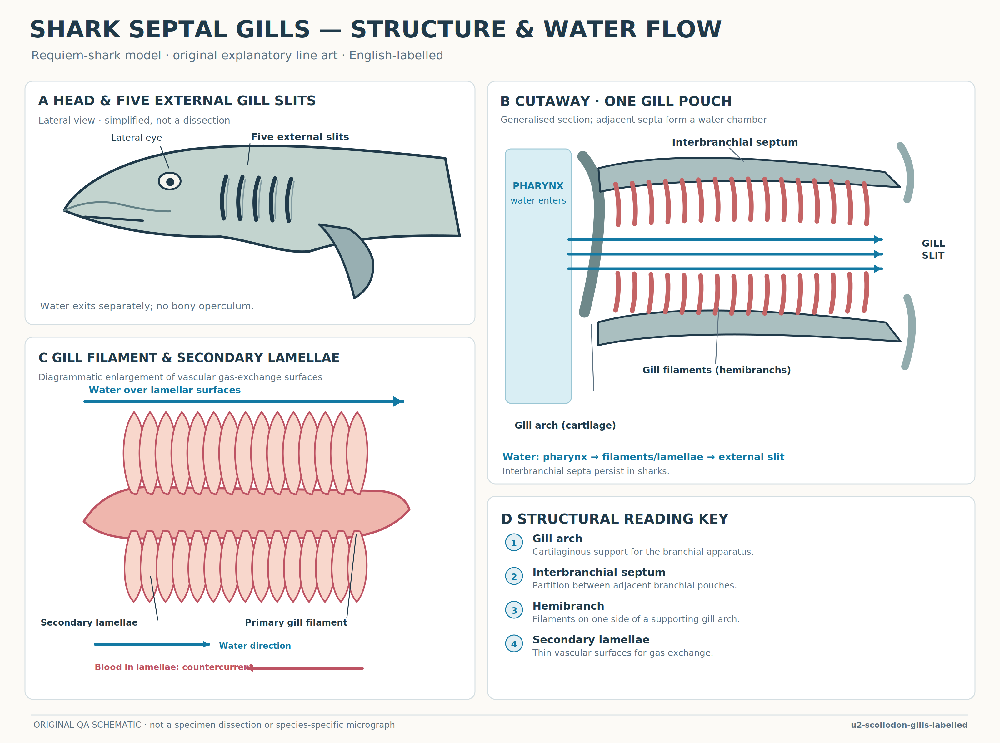

**Source PNG:** [`pencil_plates/shark_gill_flow.png`](../app/src/main/assets/pencil_plates/shark_gill_flow.png) · SHA-256: `675f497ab223df417274b8641bfc09b5a40729a4c74e419208bb08794353a90c`

**Creator:** CHORDATA QA project — original vector shark septal-gill teaching schematic · **Rights statement:** Original project illustration — scientific review pending

**Source/provenance:** Project-original source, see registered manifest · Reference: https://dlnr.hawaii.gov/sharks/anatomy/gills-respiration/

**Specific scientific review:** Check diagram morphology, arrows, labels, caption and age/taxon appropriateness.

**Scientific review status:** PENDING · **Tamil editorial status:** PENDING

**Human reviewer evidence to enter in register:** precise anatomical observations and source checked; Tamil terms/semantic accuracy; any revision requests. Do not mark `ACCEPTED` without an actual reviewer identity and evidence.

### 15. Lungfish anatomy and relationships

**Tamil title:** நுரையீரல் மீன்களின் அமைப்பும் பரிணாம உறவுகளும்

**Lesson placement:** U2 — `u2-dipnoi`, page 3, section `affinities` · **Review priority:** STANDARD

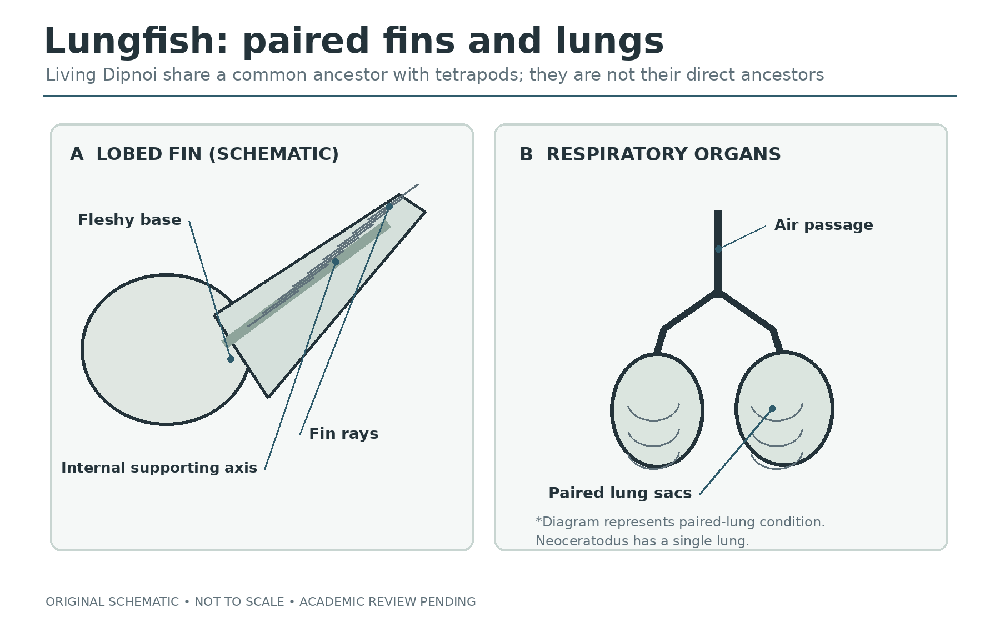

**Source PNG:** [`pencil_plates/dipnoi_lungfin_comparison_en.png`](../app/src/main/assets/pencil_plates/dipnoi_lungfin_comparison_en.png) · SHA-256: `1437c11f73c9ee05c0dec553eb9dd670181f6601d17b78796a6fdc6eaba14c31`

**Creator:** David Starr Jordan (1907), J. Green (1902), unidentified 1909 artist; CHORDATA QA original-image layout · **Rights statement:** Public domain historical zoological prints; FMIB/Commons provenance

**Source/provenance:** https://commons.wikimedia.org/wiki/File:FMIB_51710_Neoceratodus_forsteri_(Gunther)_Australia_Family_Ceratodontidae.jpeg

**Specific scientific review:** Check diagram morphology, arrows, labels, caption and age/taxon appropriateness.

**Scientific review status:** PENDING · **Tamil editorial status:** PENDING

**Human reviewer evidence to enter in register:** precise anatomical observations and source checked; Tamil terms/semantic accuracy; any revision requests. Do not mark `ACCEPTED` without an actual reviewer identity and evidence.

### 16. Comparative fish scale types

**Tamil title:** மீன் செதில்களின் ஒப்பீட்டு வகைகள்

**Lesson placement:** U2 — `u2-scales-fins`, page 1, section `scale-types` · **Review priority:** STANDARD

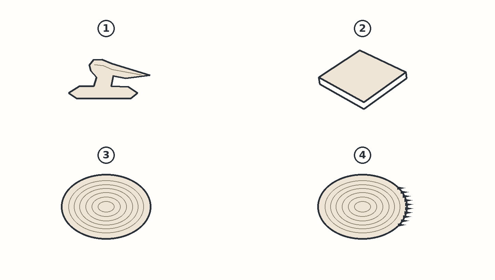

**Source PNG:** [`pencil_plates/fish_scale_types.png`](../app/src/main/assets/pencil_plates/fish_scale_types.png) · SHA-256: `e38720273c567a6704947c9371fcef287771f299d9574b8326e86eee089e5ed5`

**Creator:** Jon Houseman · **Rights statement:** CC BY-SA 3.0 Unported (attributed teaching composite)

**Source/provenance:** https://commons.wikimedia.org/wiki/File:Fishscales.png · Reference: https://govtmuseumchennai.org/uploads/topics/16528792835642.pdf

**Specific scientific review:** Check diagram morphology, arrows, labels, caption and age/taxon appropriateness.

**Scientific review status:** PENDING · **Tamil editorial status:** PENDING

**Human reviewer evidence to enter in register:** precise anatomical observations and source checked; Tamil terms/semantic accuracy; any revision requests. Do not mark `ACCEPTED` without an actual reviewer identity and evidence.

### 17. Fish fin types and positions

**Tamil title:** மீன் துடுப்புகளின் வகைகளும் அமைவிடங்களும்

**Lesson placement:** U2 — `u2-scales-fins`, page 2, section `paired-fins` · **Review priority:** STANDARD

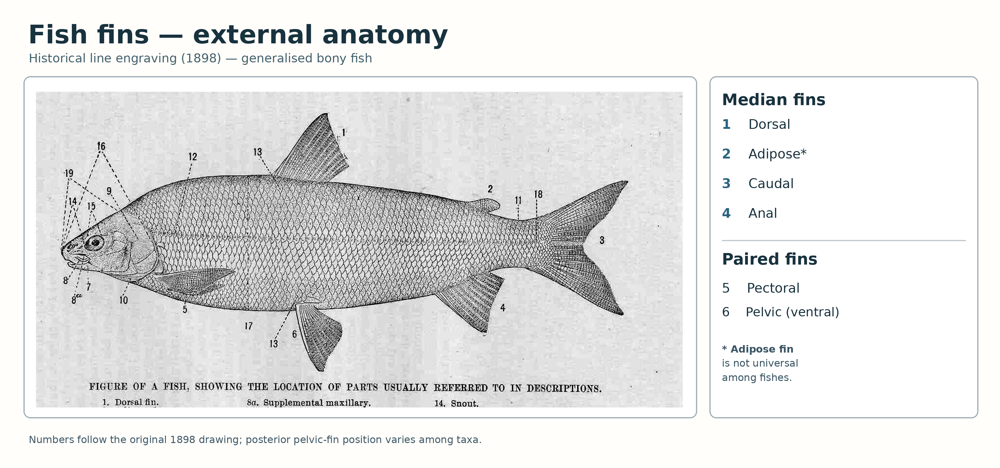

**Source PNG:** [`pencil_plates/fish_fin_positions.png`](../app/src/main/assets/pencil_plates/fish_fin_positions.png) · SHA-256: `aeba9a4f555fd14b98a9bc6852969c5b654951e9d0243271e62cdbc266f5a7d8`

**Creator:** Unknown original illustrator (1898), Oregon Fish and Game Protector; University of Washington Freshwater and Marine Image Bank; CHORDATA QA layout · **Rights statement:** Public domain — 1898 Oregon Fish and Game report, UW Freshwater and Marine Image Bank

**Source/provenance:** https://commons.wikimedia.org/wiki/File:FMIB_47883_Figure_of_a_Fish,_Showing_the_Location_of_Parts_Usually_Referred_to_in_Desciption_-_1_Dorsal_fin;_2_Adipose_fin;_3_Caudal_fin;_4.jpeg · Reference: https://www.visitflorida.com/travel-ideas/articles/florida-fishing-internal-and-external-anatomy-of-a-fish/

**Specific scientific review:** Check diagram morphology, arrows, labels, caption and age/taxon appropriateness.

**Scientific review status:** PENDING · **Tamil editorial status:** PENDING

**Human reviewer evidence to enter in register:** precise anatomical observations and source checked; Tamil terms/semantic accuracy; any revision requests. Do not mark `ACCEPTED` without an actual reviewer identity and evidence.

### 18. Accessory respiratory organs in fishes

**Tamil title:** மீன்களின் துணைச் சுவாச உறுப்புகள்

**Lesson placement:** U2 — `u2-accessory-respiration`, page 2, section `named-examples` · **Review priority:** STANDARD

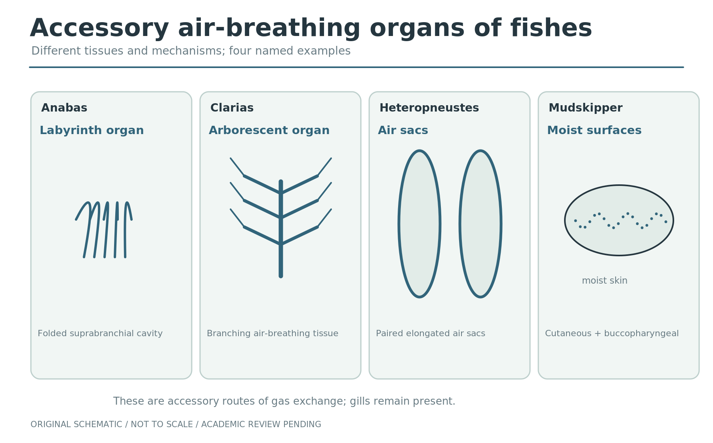

**Source PNG:** [`pencil_plates/fish_accessory_breathing_en.png`](../app/src/main/assets/pencil_plates/fish_accessory_breathing_en.png) · SHA-256: `30c841301b6042eebaf128db033fcaf2542c99cd1b4129609721320a641fa274`

**Creator:** OpenAI ImageGen — owner-selected original CHORDATA educational plate (12 November 2026) · **Rights statement:** Original AI-assisted educational illustration supplied for CHORDATA QA; scientific review pending

**Source/provenance:** Project-original source, see registered manifest

**Specific scientific review:** Check diagram morphology, arrows, labels, caption and age/taxon appropriateness.

**Scientific review status:** PENDING · **Tamil editorial status:** PENDING

**Human reviewer evidence to enter in register:** precise anatomical observations and source checked; Tamil terms/semantic accuracy; any revision requests. Do not mark `ACCEPTED` without an actual reviewer identity and evidence.

### 19. Parental-care strategies in fishes

**Tamil title:** மீன்களில் பெற்றோர் பராமரிப்பு முறைகள்

**Lesson placement:** U2 — `u2-parental-care`, page 2, section `examples` · **Review priority:** STANDARD

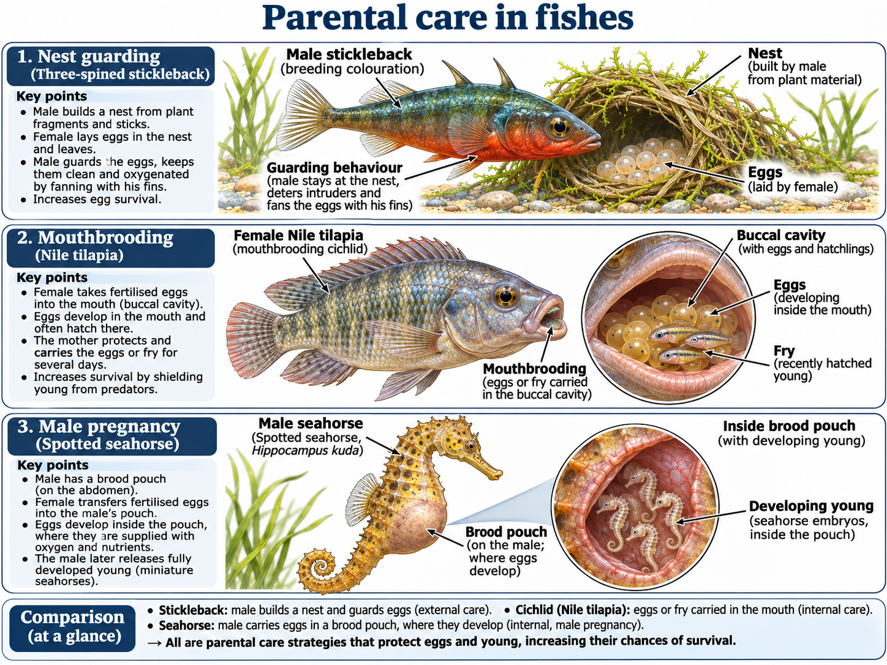

**Source PNG:** [`pencil_plates/fish_parental_care_en.png`](../app/src/main/assets/pencil_plates/fish_parental_care_en.png) · SHA-256: `8bbd87a865d337f64e537ea25f8010aea6688abd2424730afb31ef75a686137b`

**Creator:** OpenAI ImageGen — owner-selected original CHORDATA educational plate (12 November 2026) · **Rights statement:** Original AI-assisted educational illustration supplied for CHORDATA QA; scientific review pending

**Source/provenance:** Project-original source, see registered manifest

**Specific scientific review:** Check diagram morphology, arrows, labels, caption and age/taxon appropriateness.

**Scientific review status:** PENDING · **Tamil editorial status:** PENDING

**Human reviewer evidence to enter in register:** precise anatomical observations and source checked; Tamil terms/semantic accuracy; any revision requests. Do not mark `ACCEPTED` without an actual reviewer identity and evidence.

### 20. Fish migration life cycles

**Tamil title:** மீன்களின் வலசைச் சுழற்சிகள்

**Lesson placement:** U2 — `u2-migration`, page 1, section `migration-types` · **Review priority:** STANDARD

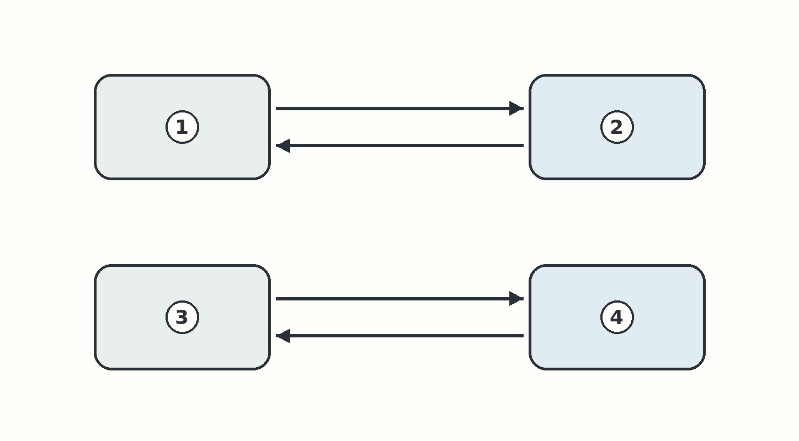

**Source PNG:** [`pencil_plates/fish_migration_cycles.png`](../app/src/main/assets/pencil_plates/fish_migration_cycles.png) · SHA-256: `f9133cf0914059e12e37af0ff3170592b7ae1a42a08875ce4a2dac4782ae7261`

**Creator:** OpenAI ImageGen — owner-selected original CHORDATA educational plate (12 November 2026) · **Rights statement:** Original AI-assisted educational illustration supplied for CHORDATA QA; scientific review pending

**Source/provenance:** Project-original source, see registered manifest · Reference: https://www.fisheries.noaa.gov/species/coho-salmon/science

**Specific scientific review:** Check diagram morphology, arrows, labels, caption and age/taxon appropriateness.

**Scientific review status:** PENDING · **Tamil editorial status:** PENDING

**Human reviewer evidence to enter in register:** precise anatomical observations and source checked; Tamil terms/semantic accuracy; any revision requests. Do not mark `ACCEPTED` without an actual reviewer identity and evidence.

### 21. Fisheries production and value chain

**Tamil title:** மீன்வள உற்பத்தியும் பொருளாதாரப் பயன்பாடுகளும்

**Lesson placement:** U2 — `u2-economic-importance`, page 1, section `nutrition-livelihood` · **Review priority:** STANDARD

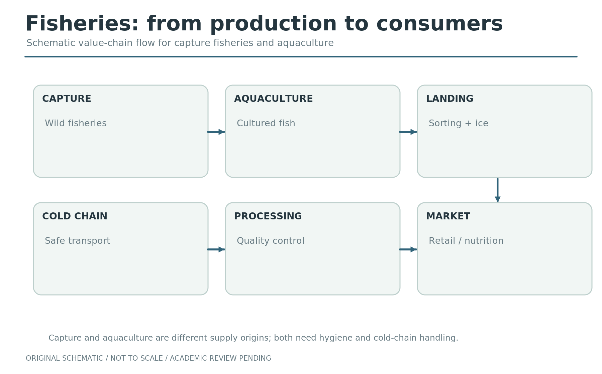

**Source PNG:** [`pencil_plates/fishery_value_chain_en.png`](../app/src/main/assets/pencil_plates/fishery_value_chain_en.png) · SHA-256: `b8e92f0384e194bdea2ea0652937262a5cb1e11fe9bf06a4c0f702d673bc8fda`

**Creator:** CHORDATA QA — original vector anatomical schematic · **Rights statement:** Original project illustration; no source images copied

**Source/provenance:** Project-original source, see registered manifest

**Specific scientific review:** Check diagram morphology, arrows, labels, caption and age/taxon appropriateness.

**Scientific review status:** PENDING · **Tamil editorial status:** PENDING

**Human reviewer evidence to enter in register:** precise anatomical observations and source checked; Tamil terms/semantic accuracy; any revision requests. Do not mark `ACCEPTED` without an actual reviewer identity and evidence.

### 22. Three living amphibian orders

**Tamil title:** தற்கால இருவாழ்விகளின் மூன்று வரிசைகள்

**Lesson placement:** U3 — `u3-amphibia-classification`, page 2, section `living-orders` · **Review priority:** STANDARD

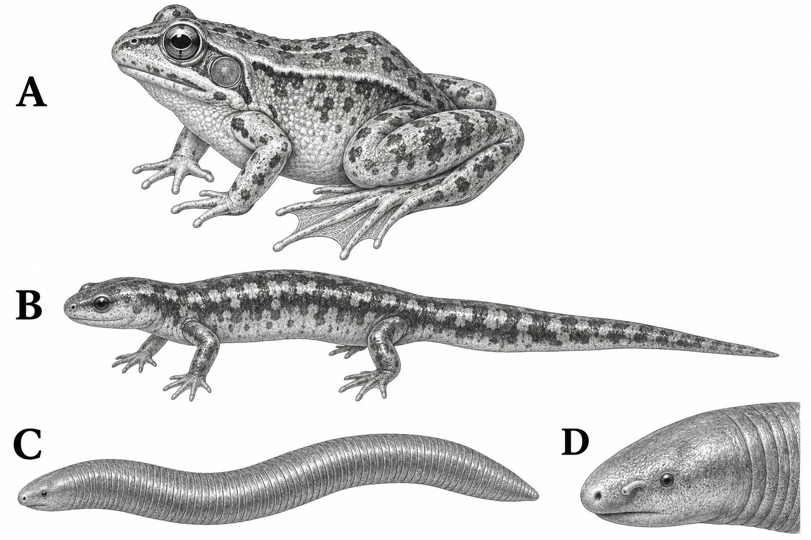

**Source PNG:** [`pencil_plates/amphibian_orders.png`](../app/src/main/assets/pencil_plates/amphibian_orders.png) · SHA-256: `c870937f5036cbfc69f7a6ed38d427a1a3d6aa1d2756a80805a25e17ee442e33`

**Creator:** AI-generated original (ChatGPT ImageGen) · **Rights statement:** Original AI-generated artwork; no third-party image reproduced

**Source/provenance:** Project-original source, see registered manifest · Reference: https://openstax.org/books/biology-2e/pages/29-3-amphibians

**Specific scientific review:** Check diagram morphology, arrows, labels, caption and age/taxon appropriateness.

**Scientific review status:** PENDING · **Tamil editorial status:** PENDING

**Human reviewer evidence to enter in register:** precise anatomical observations and source checked; Tamil terms/semantic accuracy; any revision requests. Do not mark `ACCEPTED` without an actual reviewer identity and evidence.

### 23. Amphibian life cycle and metamorphosis

**Tamil title:** இருவாழ்விகளின் வாழ்க்கைச் சுழற்சியும் உருமாற்றமும்

**Lesson placement:** U3 — `u3-amphibia-classification`, page 3, section `reproduction-ecology` · **Review priority:** STANDARD

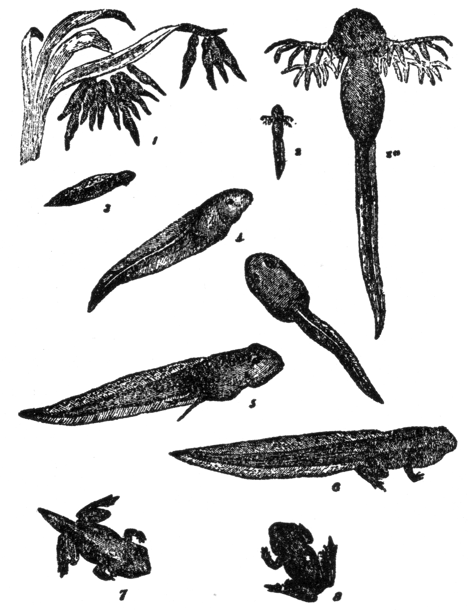

**Source PNG:** [`pencil_plates/frog_metamorphosis.png`](../app/src/main/assets/pencil_plates/frog_metamorphosis.png) · SHA-256: `ef964ec0e3b79971779ce0ed14d64dc01c6166689b2a53765dc087f6a0420f4b`

**Creator:** The How and Why Library (1909), text by Eleanor Stackhouse Atkinson; original figure illustrator not independently identified · **Rights statement:** Public domain — figure originally published in 1909; Wikimedia Commons public-domain record

**Source/provenance:** https://commons.wikimedia.org/wiki/File:The_How_and_Why_Library_-_How_a_frog_grows.png · Reference: https://commons.wikimedia.org/wiki/File:The_How_and_Why_Library_-_How_a_frog_grows.png

**Specific scientific review:** Check diagram morphology, arrows, labels, caption and age/taxon appropriateness.

**Scientific review status:** PENDING · **Tamil editorial status:** PENDING

**Human reviewer evidence to enter in register:** precise anatomical observations and source checked; Tamil terms/semantic accuracy; any revision requests. Do not mark `ACCEPTED` without an actual reviewer identity and evidence.

### 24. Devonian vertebrate transition to land

**Tamil title:** டெவோனியக் காலத்தில் நிலவாழ்விற்கான பரிணாம மாற்றம்

**Lesson placement:** U3 — `u3-origin`, page 1, section `devonian-transition` · **Review priority:** STANDARD

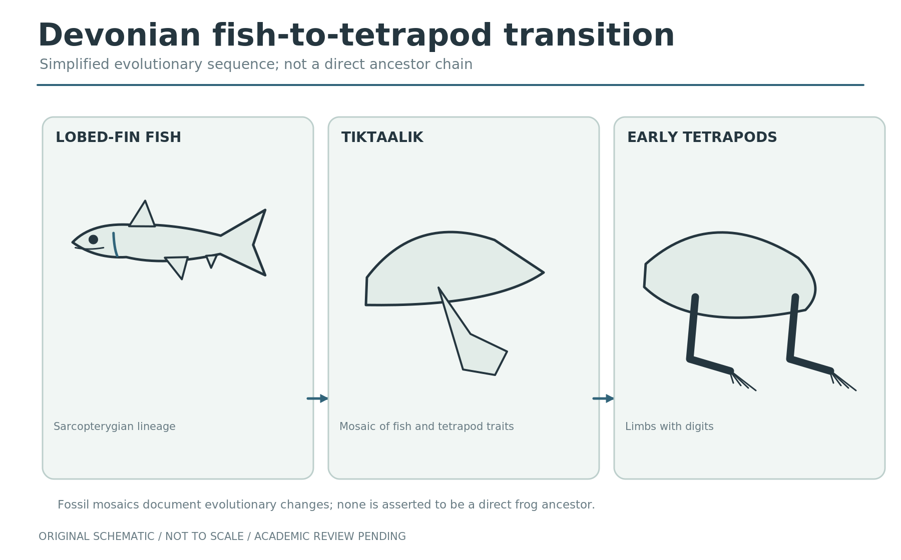

**Source PNG:** [`pencil_plates/devonian_tetrapod_transition_en.png`](../app/src/main/assets/pencil_plates/devonian_tetrapod_transition_en.png) · SHA-256: `5ccf005dc7c9729fb40ed4cb9ab7eaedf7f2180904e79417b1fd2858d9e55310`

**Creator:** Maija Karala · **Rights statement:** CC BY-SA 3.0 Unported (attributed teaching composite)

**Source/provenance:** https://commons.wikimedia.org/wiki/File:Fishapod_evolution.jpg

**Specific scientific review:** Check diagram morphology, arrows, labels, caption and age/taxon appropriateness.

**Scientific review status:** PENDING · **Tamil editorial status:** PENDING

**Human reviewer evidence to enter in register:** precise anatomical observations and source checked; Tamil terms/semantic accuracy; any revision requests. Do not mark `ACCEPTED` without an actual reviewer identity and evidence.

### 25. Indian green pond frog external morphology

**Tamil title:** பச்சைக் குளத்தவளையின் புறத்தோற்றம்

**Lesson placement:** U3 — `u3-rana`, page 1, section `external-features` · **Review priority:** STANDARD

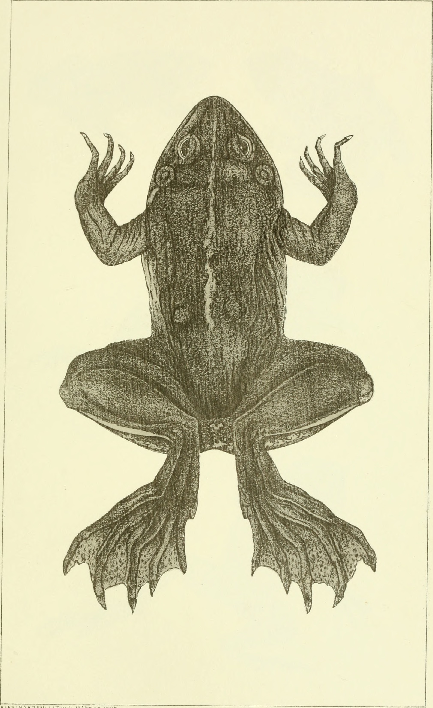

**Source PNG:** [`pencil_plates/rana_external_en.png`](../app/src/main/assets/pencil_plates/rana_external_en.png) · SHA-256: `14aff74ada05aa6282f383a1de954f2c509939449d84c79b9014f61d62ce2940`

**Creator:** Edgar Thurston (1888, editor and publisher of the Madras catalogue); original Plate III lithograph, individual lithographer not securely identified · **Rights statement:** Public domain historical Madras lithograph (1888), faithful scanned original; BHL marks book NOT_IN_COPYRIGHT

**Source/provenance:** https://commons.wikimedia.org/wiki/File:Catalogue_of_the_Batrachia_Salientia_and_Apoda_(frogs,_toads,_and_c%C2%BFcilians)_of_southern_India_(1888)_(20389957728).jpg

**Specific scientific review:** Check diagram morphology, arrows, labels, caption and age/taxon appropriateness.

**Scientific review status:** PENDING · **Tamil editorial status:** PENDING

**Human reviewer evidence to enter in register:** precise anatomical observations and source checked; Tamil terms/semantic accuracy; any revision requests. Do not mark `ACCEPTED` without an actual reviewer identity and evidence.

### 29. Comparative body plans of amphibian orders

**Tamil title:** இருவாழ்வி வரிசைகளின் ஒப்பீட்டு உடலமைப்பு

**Lesson placement:** U3 — `u3-adaptive-features`, page 3, section `apoda` · **Review priority:** STANDARD

**Source PNG:** [`pencil_plates/amphibian_orders.png`](../app/src/main/assets/pencil_plates/amphibian_orders.png) · SHA-256: `c870937f5036cbfc69f7a6ed38d427a1a3d6aa1d2756a80805a25e17ee442e33`

**Creator:** AI-generated original (ChatGPT ImageGen) · **Rights statement:** Original AI-generated artwork; no third-party image reproduced

**Source/provenance:** Project-original source, see registered manifest · Reference: https://openstax.org/books/biology-2e/pages/29-3-amphibians

**Specific scientific review:** Check diagram morphology, arrows, labels, caption and age/taxon appropriateness.

**Scientific review status:** PENDING · **Tamil editorial status:** PENDING

**Human reviewer evidence to enter in register:** precise anatomical observations and source checked; Tamil terms/semantic accuracy; any revision requests. Do not mark `ACCEPTED` without an actual reviewer identity and evidence.

### 30. Axolotl development and neoteny

**Tamil title:** ஆக்சலாட்டில் வளர்ச்சியும் இளமைப்பண்பு நிலைத்தலும்

**Lesson placement:** U3 — `u3-neoteny`, page 2, section `axolotl` · **Review priority:** STANDARD

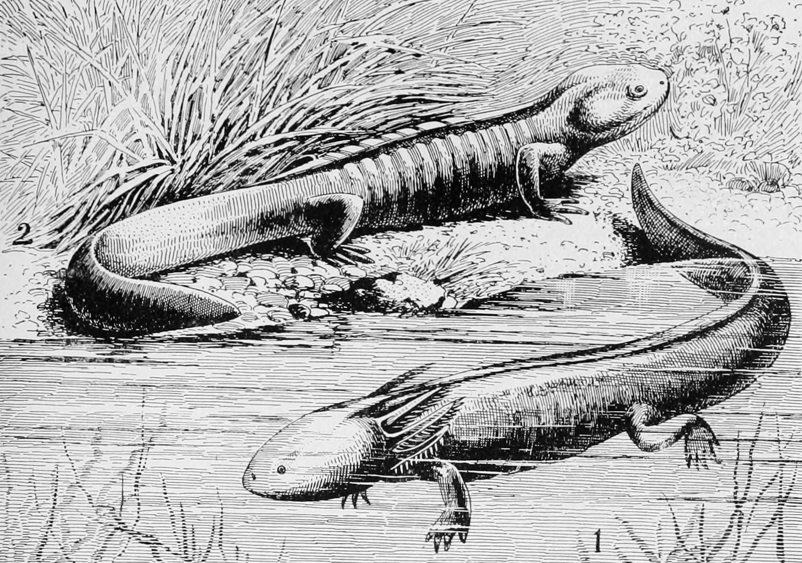

**Source PNG:** [`pencil_plates/axolotl_neoteny_en.png`](../app/src/main/assets/pencil_plates/axolotl_neoteny_en.png) · SHA-256: `fcf3c3e327d535e877d5d721eda650185bd20fcee2e383c386c9b75bb73bfa76`

**Creator:** Unidentified historical illustrator, The New International Encyclopaedia (1905), vol. 2, after p. 330; published by Dodd, Mead & Co. · **Rights statement:** Public domain — original US encyclopaedia illustration published 1905

**Source/provenance:** https://commons.wikimedia.org/wiki/File:NIE_1905_Axolotl.png · Reference: https://commons.wikimedia.org/wiki/File:NIE_1905_Axolotl.png

**Specific scientific review:** Check diagram morphology, arrows, labels, caption and age/taxon appropriateness.

**Scientific review status:** PENDING · **Tamil editorial status:** PENDING

**Human reviewer evidence to enter in register:** precise anatomical observations and source checked; Tamil terms/semantic accuracy; any revision requests. Do not mark `ACCEPTED` without an actual reviewer identity and evidence.

### 31. Parental care in amphibians

**Tamil title:** இருவாழ்விகளில் பெற்றோர் பராமரிப்பு

**Lesson placement:** U3 — `u3-parental-care`, page 2, section `frog-examples` · **Review priority:** STANDARD

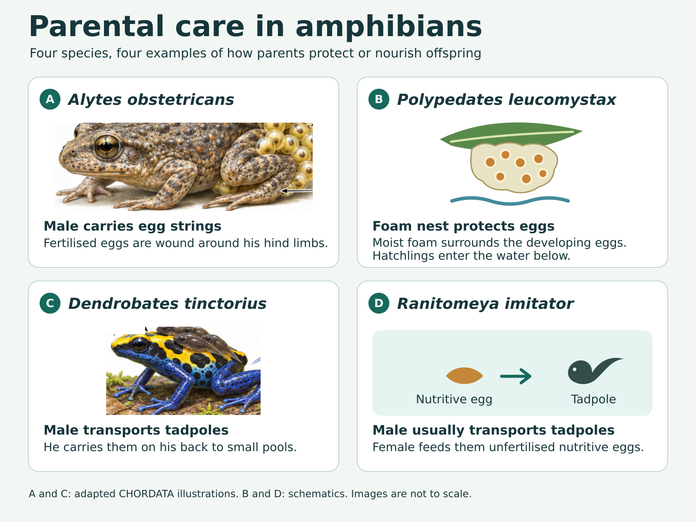

**Source PNG:** [`pencil_plates/amphibian_parental_care_en.png`](../app/src/main/assets/pencil_plates/amphibian_parental_care_en.png) · SHA-256: `5e65932b980f9dc21d83d2d00e379432fdbf212cd200226a0889daae1037aa6f`

**Creator:** CHORDATA editorial project — original layout and schematics with two adapted OpenAI ImageGen illustrations · **Rights statement:** Original CHORDATA educational illustration with project AI-assisted artwork excerpts; independent review pending

**Source/provenance:** Project-original source, see registered manifest

**Specific scientific review:** Check diagram morphology, arrows, labels, caption and age/taxon appropriateness.

**Scientific review status:** PENDING · **Tamil editorial status:** PENDING

**Human reviewer evidence to enter in register:** precise anatomical observations and source checked; Tamil terms/semantic accuracy; any revision requests. Do not mark `ACCEPTED` without an actual reviewer identity and evidence.

### 32. Living reptilian lineages

**Tamil title:** தற்கால ஊர்வனவற்றின் முக்கிய வகைப்பாட்டுக் குழுக்கள்

**Lesson placement:** U4 — `u4-reptilia-classification`, page 2, section `living-orders` · **Review priority:** STANDARD

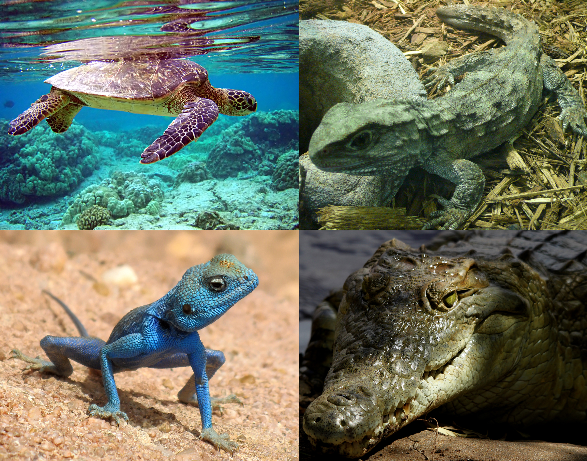

**Source PNG:** [`pencil_plates/living_reptile_groups_en.png`](../app/src/main/assets/pencil_plates/living_reptile_groups_en.png) · SHA-256: `8f47ff3fb6091fa531ade3b33affce65c7ff28d76eacbd7685da8098fb547a8d`

**Creator:** Petter Bøckman (2012) four-reptile montage; component photos by Mila Zinkova, TimVickers, Ester Inbar and Donald Macauley · **Rights statement:** CC BY-SA 3.0 Unported — original photo montage by Petter Bøckman; component rights/credits retained

**Source/provenance:** https://commons.wikimedia.org/wiki/File:Extant_reptilia.jpg

**Specific scientific review:** Check diagram morphology, arrows, labels, caption and age/taxon appropriateness.

**Scientific review status:** PENDING · **Tamil editorial status:** PENDING

**Human reviewer evidence to enter in register:** precise anatomical observations and source checked; Tamil terms/semantic accuracy; any revision requests. Do not mark `ACCEPTED` without an actual reviewer identity and evidence.

### 33. Calotes external morphology

**Tamil title:** ஓணானின் புறத்தோற்றம்

**Lesson placement:** U4 — `u4-calotes`, page 1, section `external-features` · **Review priority:** STANDARD

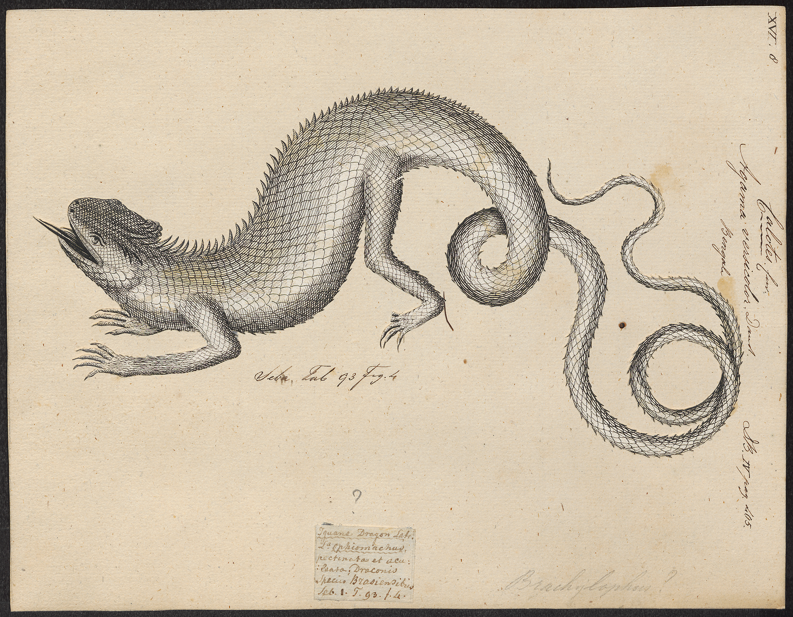

**Source PNG:** [`pencil_plates/calotes_external_en.png`](../app/src/main/assets/pencil_plates/calotes_external_en.png) · SHA-256: `8439ff408895aaa1eb8f59e2192af79c30a45f81d6186af2f8b2b2664eacaf66`

**Creator:** Azim Khan Ronnie (original photograph); CHORDATA QA (lossless PNG adaptation) · **Rights statement:** CC BY-SA 4.0 — adapted photographic PNG; attribution and share-alike apply

**Source/provenance:** https://commons.wikimedia.org/wiki/File:Oriental_Lizard.jpg

**Specific scientific review:** Check diagram morphology, arrows, labels, caption and age/taxon appropriateness.

**Scientific review status:** PENDING · **Tamil editorial status:** PENDING

**Human reviewer evidence to enter in register:** precise anatomical observations and source checked; Tamil terms/semantic accuracy; any revision requests. Do not mark `ACCEPTED` without an actual reviewer identity and evidence.

### 34. Calotes digestive system

**Tamil title:** ஓணானின் செரிமான மண்டலம்

**Lesson placement:** U4 — `u4-calotes`, page 2, section `digestive-system` · **Review priority:** STANDARD

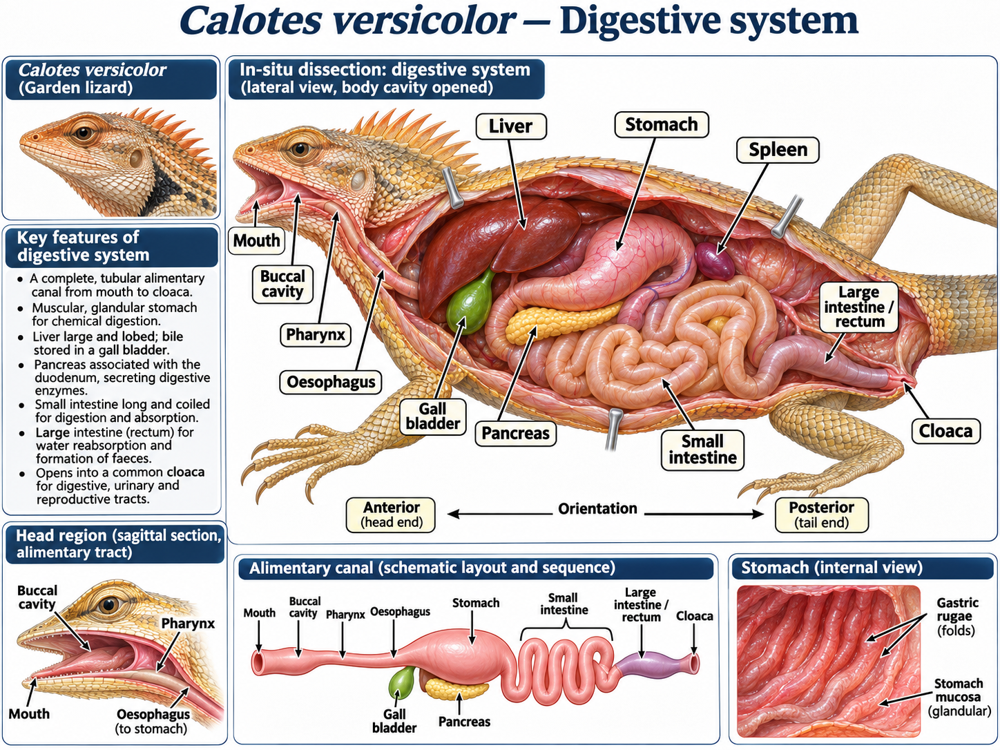

**Source PNG:** [`pencil_plates/calotes_digestive_en.png`](../app/src/main/assets/pencil_plates/calotes_digestive_en.png) · SHA-256: `5da6f592cd726621ff5df240ebb506d9dc7142d95c03e6bfc99d89eede55834b`

**Creator:** OpenAI ImageGen — owner-selected original CHORDATA educational plate (12 November 2026) · **Rights statement:** Original AI-assisted educational illustration supplied for CHORDATA QA; scientific review pending

**Source/provenance:** Project-original source, see registered manifest

**Specific scientific review:** Check diagram morphology, arrows, labels, caption and age/taxon appropriateness.

**Scientific review status:** PENDING · **Tamil editorial status:** PENDING

**Human reviewer evidence to enter in register:** precise anatomical observations and source checked; Tamil terms/semantic accuracy; any revision requests. Do not mark `ACCEPTED` without an actual reviewer identity and evidence.

### 35. Calotes respiratory system

**Tamil title:** ஓணானின் சுவாச மண்டலம்

**Lesson placement:** U4 — `u4-calotes`, page 3, section `respiratory-system` · **Review priority:** STANDARD

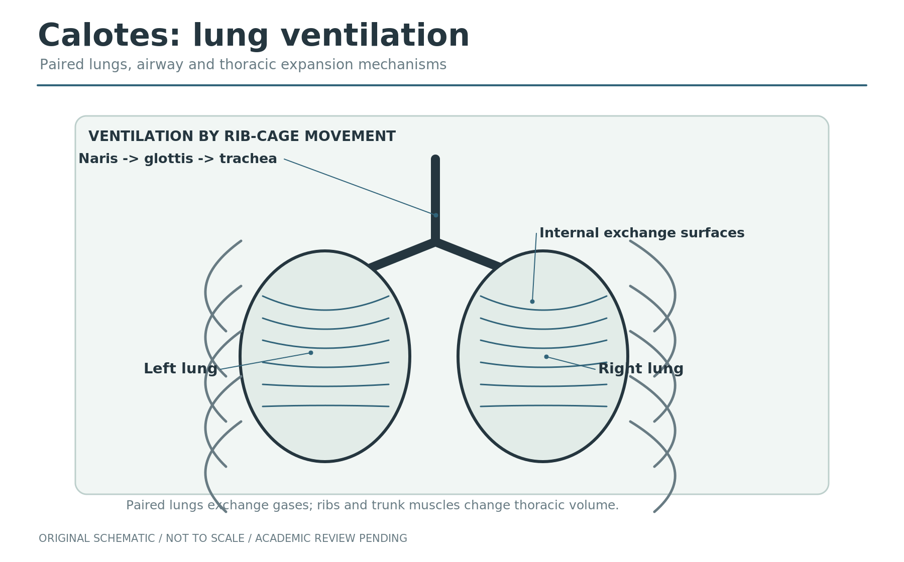

**Source PNG:** [`pencil_plates/calotes_respiratory_en.png`](../app/src/main/assets/pencil_plates/calotes_respiratory_en.png) · SHA-256: `5f63ba851ba074880db5ddecf044c24490173327903b9435e793f63f874eeae4`

**Creator:** OpenAI ImageGen — owner-selected original CHORDATA educational plate (12 November 2026) · **Rights statement:** Original AI-assisted educational illustration supplied for CHORDATA QA; scientific review pending

**Source/provenance:** Project-original source, see registered manifest

**Specific scientific review:** Check diagram morphology, arrows, labels, caption and age/taxon appropriateness.

**Scientific review status:** PENDING · **Tamil editorial status:** PENDING

**Human reviewer evidence to enter in register:** precise anatomical observations and source checked; Tamil terms/semantic accuracy; any revision requests. Do not mark `ACCEPTED` without an actual reviewer identity and evidence.

### 39. Selected extinct reptilian lineages

**Tamil title:** அழிந்துபோன ஊர்வனவற்றின் முக்கிய குழுக்கள்

**Lesson placement:** U4 — `u4-origin-extinct`, page 2, section `extinct-lineages` · **Review priority:** STANDARD

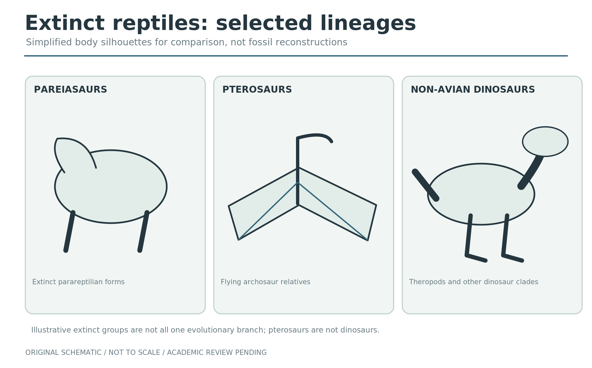

**Source PNG:** [`pencil_plates/extinct_reptile_lineages_en.png`](../app/src/main/assets/pencil_plates/extinct_reptile_lineages_en.png) · SHA-256: `c36f69163bd291ee663f54c1575e6de3dd52caa80d6990cdb5bd81b02a367f18`

**Creator:** OpenAI ImageGen — owner-selected original CHORDATA educational plate (12 November 2026) · **Rights statement:** Original AI-assisted educational illustration supplied for CHORDATA QA; scientific review pending

**Source/provenance:** Project-original source, see registered manifest

**Specific scientific review:** Check diagram morphology, arrows, labels, caption and age/taxon appropriateness.

**Scientific review status:** PENDING · **Tamil editorial status:** PENDING

**Human reviewer evidence to enter in register:** precise anatomical observations and source checked; Tamil terms/semantic accuracy; any revision requests. Do not mark `ACCEPTED` without an actual reviewer identity and evidence.

### 41. Snake venom gland, duct and fang mechanism

**Tamil title:** பாம்பின் நஞ்சுச் சுரப்பி, குழாய் மற்றும் நஞ்சுப்பல் அமைப்பு

**Lesson placement:** U4 — `u4-poison-apparatus`, page 1, section `venom-apparatus` · **Review priority:** STANDARD

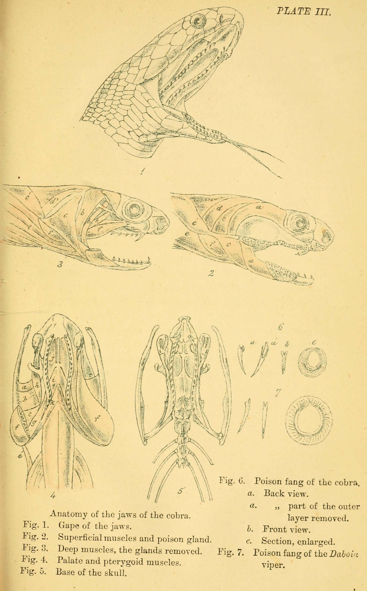

**Source PNG:** [`pencil_plates/snake_venom_delivery_en.png`](../app/src/main/assets/pencil_plates/snake_venom_delivery_en.png) · SHA-256: `e148ff90ecfe32060f019a60aa09e5ab512317dd1d0a6d9e1da8b2b4bf3c81af`

**Creator:** Edward Nicholson, Indian Snakes (1874), Plate III; original plate illustrator unidentified; Biodiversity Heritage Library scan · **Rights statement:** Public domain original 1874 anatomical plate; BHL mechanical source scan

**Source/provenance:** https://commons.wikimedia.org/wiki/File:Indian_snakes_(Plate_III)_BHL4390486.jpg

**Specific scientific review:** Check diagram morphology, arrows, labels, caption and age/taxon appropriateness.

**Scientific review status:** PENDING · **Tamil editorial status:** PENDING

**Human reviewer evidence to enter in register:** precise anatomical observations and source checked; Tamil terms/semantic accuracy; any revision requests. Do not mark `ACCEPTED` without an actual reviewer identity and evidence.

### 43. Temporal openings in vertebrate skulls

**Tamil title:** முதுகெலும்பிகளின் மண்டையோட்டுப் பக்கவாட்டுத் திறப்புகள்

**Lesson placement:** U4 — `u4-skull`, page 1, section `temporal-fenestrae` · **Review priority:** STANDARD

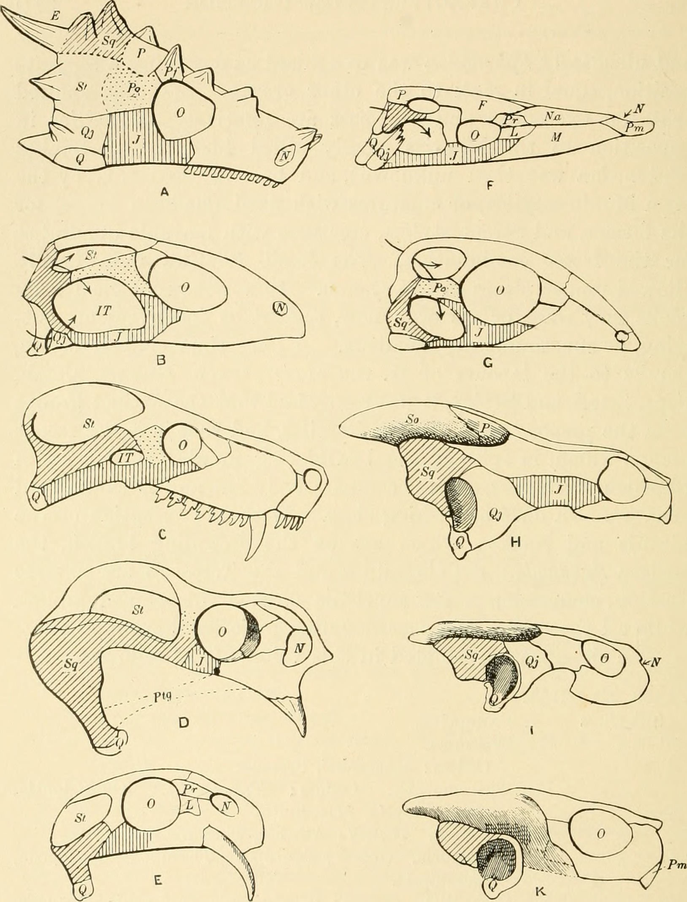

**Source PNG:** [`pencil_plates/temporal_fenestrae.png`](../app/src/main/assets/pencil_plates/temporal_fenestrae.png) · SHA-256: `e8f29b8b0f579da071d2b401caa50b35ab08fee51ae30b7c03fc17d4f186e9c8`

**Creator:** Hans Gadow, Amphibia and Reptiles, The Cambridge Natural History, vol. VIII (1901), Fig. 54; individual original draughtsperson not established · **Rights statement:** Public domain — original published 1901 natural-history skull engravings

**Source/provenance:** https://commons.wikimedia.org/wiki/File:Amphibia_and_reptiles_(1901)_(17979294289).jpg · Reference: https://commons.wikimedia.org/wiki/File:Amphibia_and_reptiles_(1901)_(17979294289).jpg

**Specific scientific review:** Check diagram morphology, arrows, labels, caption and age/taxon appropriateness.

**Scientific review status:** PENDING · **Tamil editorial status:** PENDING

**Human reviewer evidence to enter in register:** precise anatomical observations and source checked; Tamil terms/semantic accuracy; any revision requests. Do not mark `ACCEPTED` without an actual reviewer identity and evidence.

### 44. Evolutionary relationships of major bird lineages

**Tamil title:** பறவைகளின் முக்கிய பரிணாமக் குழுக்களின் உறவுகள்

**Lesson placement:** U5 — `u5-aves-classification`, page 2, section `modern-classification` · **Review priority:** STANDARD

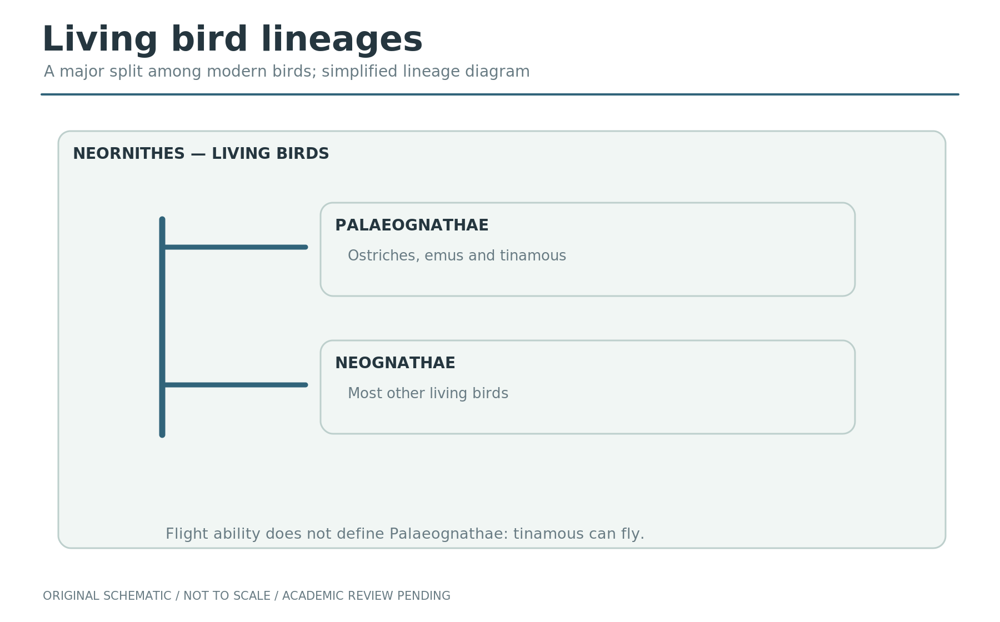

**Source PNG:** [`pencil_plates/living_bird_phylogeny_en.png`](../app/src/main/assets/pencil_plates/living_bird_phylogeny_en.png) · SHA-256: `ce2378fa9c28026090f2b895a930a46a6e9d62135ac0b11ab61da080666cfb25`

**Creator:** CHORDATA QA — original vector anatomical schematic · **Rights statement:** Original project illustration; no source images copied

**Source/provenance:** Project-original source, see registered manifest

**Specific scientific review:** Check diagram morphology, arrows, labels, caption and age/taxon appropriateness.

**Scientific review status:** PENDING · **Tamil editorial status:** PENDING

**Human reviewer evidence to enter in register:** precise anatomical observations and source checked; Tamil terms/semantic accuracy; any revision requests. Do not mark `ACCEPTED` without an actual reviewer identity and evidence.

### 45. Rock pigeon external morphology

**Tamil title:** மாடப்புறாவின் புறத்தோற்றம்

**Lesson placement:** U5 — `u5-columba`, page 1, section `external-features` · **Review priority:** STANDARD

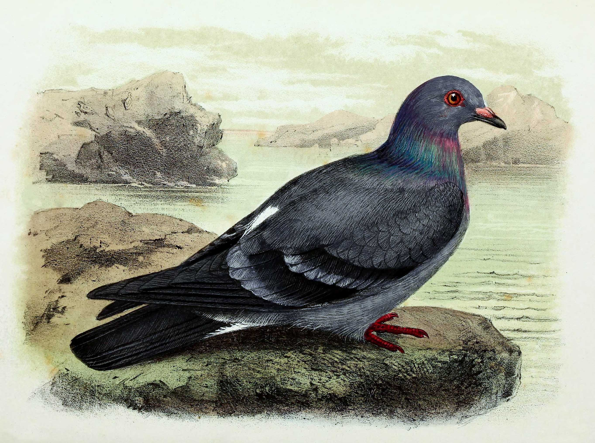

**Source PNG:** [`pencil_plates/pigeon_external_anatomy_en.png`](../app/src/main/assets/pencil_plates/pigeon_external_anatomy_en.png) · SHA-256: `38d10a35534d7b1a7f1d0d80c400248e069ad07a0fc3bb6c8f0367f18afb5b01`

**Creator:** John Gerrard Keulemans (1842–1912); original Columba livia zoological plate (1873) · **Rights statement:** Public domain historical original (1873; artist died 1912), faithful original scan

**Source/provenance:** https://commons.wikimedia.org/wiki/File:Columba_livia_1873.jpg

**Specific scientific review:** Check diagram morphology, arrows, labels, caption and age/taxon appropriateness.

**Scientific review status:** PENDING · **Tamil editorial status:** PENDING

**Human reviewer evidence to enter in register:** precise anatomical observations and source checked; Tamil terms/semantic accuracy; any revision requests. Do not mark `ACCEPTED` without an actual reviewer identity and evidence.

### 46. Pigeon endoskeleton and flight adaptations

**Tamil title:** புறாவின் உள் எலும்புக்கூடும் பறத்தல் தகவமைப்புகளும்

**Lesson placement:** U5 — `u5-columba`, page 2, section `endoskeleton` · **Review priority:** STANDARD

**Source PNG:** [`pencil_plates/columba_skeleton_en.png`](../app/src/main/assets/pencil_plates/columba_skeleton_en.png) · SHA-256: `15213b2c1423a5d1342f133e22f97cd41de94ddf030bf5c2e8ccbd891ed15130`

**Creator:** Adolf Bernhard Meyer · **Rights statement:** Public domain — historical 19th-century illustration

**Source/provenance:** https://commons.wikimedia.org/wiki/File:Abbildungen_von_Vogel-Skeletten_(Tafel_XC)_(6981817141).jpg

**Specific scientific review:** Check diagram morphology, arrows, labels, caption and age/taxon appropriateness.

**Scientific review status:** PENDING · **Tamil editorial status:** PENDING

**Additional TA variant:** [`pencil_plates/columba_skeleton_ta.png`](../app/src/main/assets/pencil_plates/columba_skeleton_ta.png) · SHA-256 `358c4d80563995f9b48e744df6d5cd0d924b40ece64bba2d31eb0e59530a8760` · AI-generated original (ChatGPT ImageGen) · AI-generated for CHORDATA; project-owner-authorised app distribution (no exclusive copyright or third-party reuse licence asserted)

**Human reviewer evidence to enter in register:** precise anatomical observations and source checked; Tamil terms/semantic accuracy; any revision requests. Do not mark `ACCEPTED` without an actual reviewer identity and evidence.

### 48. Pigeon eye, ear and other sense organs

**Tamil title:** புறாவின் கண், காது மற்றும் பிற உணர்வு உறுப்புகள்

**Lesson placement:** U5 — `u5-columba`, page 4, section `sense-organs` · **Review priority:** STANDARD

**Source PNG:** [`pencil_plates/pigeon_eye_ear_en.png`](../app/src/main/assets/pencil_plates/pigeon_eye_ear_en.png) · SHA-256: `3873ea66a86d85407e9a120f78b267c4b31f61b6ae59e8a30f5c6408dcdf1a29`

**Creator:** Original engraver not identified; The New International Encyclopaedia, vol. 3 (1905), bird anatomy article by Ernest Ingersoll · **Rights statement:** Public domain; two published bird-anatomy engravings from the New International Encyclopaedia (1905)

**Source/provenance:** https://commons.wikimedia.org/wiki/File:NIE_1905_Bird_-_eye_structure.jpg

**Specific scientific review:** Check diagram morphology, arrows, labels, caption and age/taxon appropriateness.

**Scientific review status:** PENDING · **Tamil editorial status:** PENDING

**Human reviewer evidence to enter in register:** precise anatomical observations and source checked; Tamil terms/semantic accuracy; any revision requests. Do not mark `ACCEPTED` without an actual reviewer identity and evidence.

### 49. Wing aerofoil and lift

**Tamil title:** பறவை இறக்கையின் காற்றியக்க அமைப்பும் தூக்கு விசையும்

**Lesson placement:** U5 — `u5-flight-adaptations`, page 1, section `wing-aerodynamics` · **Review priority:** STANDARD

**Source PNG:** [`pencil_plates/avian_aerofoil_en.png`](../app/src/main/assets/pencil_plates/avian_aerofoil_en.png) · SHA-256: `3e100e287351226a1f724b9daec79a816a46d7c1c988edbf0240244222a029cf`

**Creator:** CHORDATA QA — original vector anatomical schematic · **Rights statement:** Original project illustration; no source images copied

**Source/provenance:** Project-original source, see registered manifest

**Specific scientific review:** Check diagram morphology, arrows, labels, caption and age/taxon appropriateness.

**Scientific review status:** PENDING · **Tamil editorial status:** PENDING

**Human reviewer evidence to enter in register:** precise anatomical observations and source checked; Tamil terms/semantic accuracy; any revision requests. Do not mark `ACCEPTED` without an actual reviewer identity and evidence.

### 50. Flight muscles and keeled sternum

**Tamil title:** பறத்தல் தசைகளும் முகடுடைய மார்பெலும்பும்

**Lesson placement:** U5 — `u5-flight-adaptations`, page 2, section `muscles-skeleton` · **Review priority:** STANDARD

**Source PNG:** [`pencil_plates/avian_flight_muscles_en.png`](../app/src/main/assets/pencil_plates/avian_flight_muscles_en.png) · SHA-256: `3b424eb0227d3b770035b062c22aa5e4923b7f3195a096f39de17154a0c58d50`

**Creator:** L. Shyamal; CHORDATA QA (educational presentation) · **Rights statement:** CC BY-SA 2.5 — derivative layout credited to all source creators

**Source/provenance:** https://commons.wikimedia.org/wiki/File:Wing_Muscles,_color.svg

**Specific scientific review:** Check diagram morphology, arrows, labels, caption and age/taxon appropriateness.

**Scientific review status:** PENDING · **Tamil editorial status:** PENDING

**Human reviewer evidence to enter in register:** precise anatomical observations and source checked; Tamil terms/semantic accuracy; any revision requests. Do not mark `ACCEPTED` without an actual reviewer identity and evidence.

### 53. Major mammalian lineages

**Tamil title:** பாலூட்டிகளின் முக்கிய பரிணாமக் குழுக்கள்

**Lesson placement:** U5 — `u5-mammalia-classification`, page 2, section `living-mammal-lineages` · **Review priority:** STANDARD

**Source PNG:** [`pencil_plates/living_mammal_lineages_en.png`](../app/src/main/assets/pencil_plates/living_mammal_lineages_en.png) · SHA-256: `86f40d17432f9376f5f1fa3e1e1060f60957448e3d649c71fc98ebfb076cc575`

**Creator:** CHORDATA QA — original vector anatomical schematic · **Rights statement:** Original project illustration; no source images copied

**Source/provenance:** Project-original source, see registered manifest

**Specific scientific review:** Check diagram morphology, arrows, labels, caption and age/taxon appropriateness.

**Scientific review status:** PENDING · **Tamil editorial status:** PENDING

**Human reviewer evidence to enter in register:** precise anatomical observations and source checked; Tamil terms/semantic accuracy; any revision requests. Do not mark `ACCEPTED` without an actual reviewer identity and evidence.

### 54. Rabbit external morphology

**Tamil title:** முயலின் புறத்தோற்றம்

**Lesson placement:** U5 — `u5-rabbit`, page 1, section `external-features` · **Review priority:** STANDARD

**Source PNG:** [`pencil_plates/rabbit_external_anatomy_en.png`](../app/src/main/assets/pencil_plates/rabbit_external_anatomy_en.png) · SHA-256: `9a5c6e1a7870bbebb42725604ce05d96820a5fc3ae35efdbe0970639609a0f7c`

**Creator:** Jacques Christophe Werner (1798-1856), Histoire naturelle des mammiferes (1824); Commons extract · **Rights statement:** Public domain — Werner artwork published 1824; digitised Commons extract

**Source/provenance:** https://commons.wikimedia.org/wiki/File:Lepus_cuniculus_-_1700-1880_-_Print_-_Iconographia_Zoologica_-(white_background).jpg

**Specific scientific review:** Check diagram morphology, arrows, labels, caption and age/taxon appropriateness.

**Scientific review status:** PENDING · **Tamil editorial status:** PENDING

**Human reviewer evidence to enter in register:** precise anatomical observations and source checked; Tamil terms/semantic accuracy; any revision requests. Do not mark `ACCEPTED` without an actual reviewer identity and evidence.

### 55. Rabbit endoskeleton

**Tamil title:** முயலின் உள் எலும்புக்கூடு

**Lesson placement:** U5 — `u5-rabbit`, page 2, section `endoskeleton` · **Review priority:** STANDARD

**Source PNG:** [`pencil_plates/rabbit_skeleton_en.png`](../app/src/main/assets/pencil_plates/rabbit_skeleton_en.png) · SHA-256: `25a9d4a68486c54068caea46163d6007c1b0ca0b225f4915cf9a8ed5220939f9`

**Creator:** Auguste Chauveau and Saturnin Arloing (1890); Commons digitisation credited to Meyer C. · **Rights statement:** Public domain — historical 1890 illustration

**Source/provenance:** https://commons.wikimedia.org/wiki/File:SqueletteLapinChauveau1990.JPG

**Specific scientific review:** Check diagram morphology, arrows, labels, caption and age/taxon appropriateness.

**Scientific review status:** PENDING · **Tamil editorial status:** PENDING

**Additional TA variant:** [`pencil_plates/rabbit_skeleton_ta.png`](../app/src/main/assets/pencil_plates/rabbit_skeleton_ta.png) · SHA-256 `25a9d4a68486c54068caea46163d6007c1b0ca0b225f4915cf9a8ed5220939f9` · Auguste Chauveau and Saturnin Arloing (1890); Commons digitisation credited to Meyer C. · Public domain — historical 1890 illustration

**Human reviewer evidence to enter in register:** precise anatomical observations and source checked; Tamil terms/semantic accuracy; any revision requests. Do not mark `ACCEPTED` without an actual reviewer identity and evidence.

### 58. Rabbit sense organs

**Tamil title:** முயலின் உணர்வு உறுப்புகள்

**Lesson placement:** U5 — `u5-rabbit`, page 5, section `sense-organs` · **Review priority:** STANDARD

**Source PNG:** [`pencil_plates/rabbit_senses_en.png`](../app/src/main/assets/pencil_plates/rabbit_senses_en.png) · SHA-256: `868ca1fa8803f902e8cbea393de70141365d7ed932d0136749651114bb95ced9`

**Creator:** Trougnouf (Benoit Brummer) (original photograph); CHORDATA QA (original educational labels) · **Rights statement:** CC BY 4.0 — captioned educational derivative with original attribution

**Source/provenance:** https://commons.wikimedia.org/wiki/File:Side_view_of_the_head_of_a_pet_rabbit_in_Brussels_(DSCF0830).jpg

**Specific scientific review:** Check diagram morphology, arrows, labels, caption and age/taxon appropriateness.

**Scientific review status:** PENDING · **Tamil editorial status:** PENDING

**Human reviewer evidence to enter in register:** precise anatomical observations and source checked; Tamil terms/semantic accuracy; any revision requests. Do not mark `ACCEPTED` without an actual reviewer identity and evidence.

### 59. Monotreme reproduction and milk feeding

**Tamil title:** முட்டையிடும் பாலூட்டிகளின் இனப்பெருக்கமும் பால் ஊட்டுதலும்

**Lesson placement:** U5 — `u5-egg-laying-mammals`, page 2, section `milk-and-young` · **Review priority:** STANDARD

**Source PNG:** [`pencil_plates/platypus_reproduction.png`](../app/src/main/assets/pencil_plates/platypus_reproduction.png) · SHA-256: `018d3e2e8c0c4dc4c7edf34cb60fbf92e8446386e9fe765ce09d9d9346a53e6b`

**Creator:** Eric Chan (platypus photograph); Ian R McCann, Museums Victoria (echidna puggle photograph); F. E. Beddard (1902 anatomical plate); CHORDATA QA (comparison captions) · **Rights statement:** Composite educational adaptation under CC BY-SA 4.0; source platypus CC BY 2.0, echidna puggle CC BY-SA 4.0, historical anatomy public domain

**Source/provenance:** https://commons.wikimedia.org/wiki/File:Platypus_(4848256613).jpg · Reference: https://nre.tas.gov.au/wildlife-management/fauna-of-tasmania/mammals/echidnas-and-platypus/platypus/platypus-in-tasmania

**Specific scientific review:** Check diagram morphology, arrows, labels, caption and age/taxon appropriateness.

**Scientific review status:** PENDING · **Tamil editorial status:** PENDING

**Human reviewer evidence to enter in register:** precise anatomical observations and source checked; Tamil terms/semantic accuracy; any revision requests. Do not mark `ACCEPTED` without an actual reviewer identity and evidence.

### 60. Marsupial reproduction and young development

**Tamil title:** பைம்மாப் பாலூட்டிகளின் இனப்பெருக்கமும் குட்டி வளர்ச்சியும்

**Lesson placement:** U5 — `u5-marsupials`, page 1, section `reproductive-pattern` · **Review priority:** STANDARD

**Source PNG:** [`pencil_plates/marsupial_life_cycle_en.png`](../app/src/main/assets/pencil_plates/marsupial_life_cycle_en.png) · SHA-256: `36a23af112b64db609f732bbcdb789e231717f2c798694336fb67578259b6a0a`

**Creator:** Johnscotaus; CHORDATA QA (educational presentation) · **Rights statement:** CC BY-SA 4.0 — derivative layout credited to all source creators

**Source/provenance:** https://commons.wikimedia.org/wiki/File:Baby_kangaroo_in_pouch.jpg

**Specific scientific review:** Check diagram morphology, arrows, labels, caption and age/taxon appropriateness.

**Scientific review status:** PENDING · **Tamil editorial status:** PENDING

**Human reviewer evidence to enter in register:** precise anatomical observations and source checked; Tamil terms/semantic accuracy; any revision requests. Do not mark `ACCEPTED` without an actual reviewer identity and evidence.

### 61. Bat wing contrasted with gliding membrane

**Tamil title:** வெளவாலின் இறக்கையும் சறுக்கிப் பறக்கும் பாலூட்டிகளின் சவ்வும்

**Lesson placement:** U5 — `u5-flying-mammals`, page 1, section `bats-true-flight` · **Review priority:** STANDARD

**Source PNG:** [`pencil_plates/bat_glider_comparison_en.png`](../app/src/main/assets/pencil_plates/bat_glider_comparison_en.png) · SHA-256: `a28bc2f6ea0854067f9e8ab13adc9ccd0a38e34d7cecb9c38a29a6be64d11593`

**Creator:** OpenAI ImageGen — owner-selected original CHORDATA educational plate (12 November 2026) · **Rights statement:** Original AI-assisted educational illustration supplied for CHORDATA QA; scientific review pending

**Source/provenance:** Project-original source, see registered manifest

**Specific scientific review:** Check diagram morphology, arrows, labels, caption and age/taxon appropriateness.

**Scientific review status:** PENDING · **Tamil editorial status:** PENDING

**Human reviewer evidence to enter in register:** precise anatomical observations and source checked; Tamil terms/semantic accuracy; any revision requests. Do not mark `ACCEPTED` without an actual reviewer identity and evidence.

### 62. Major aquatic mammal groups

**Tamil title:** நீர்வாழ் பாலூட்டிகளின் முக்கிய குழுக்கள்

**Lesson placement:** U5 — `u5-aquatic-mammals`, page 1, section `marine-lineages` · **Review priority:** STANDARD

**Source PNG:** [`pencil_plates/aquatic_mammal_lineages_en.png`](../app/src/main/assets/pencil_plates/aquatic_mammal_lineages_en.png) · SHA-256: `491c242f293c2ed2f2f77a73a73b551b673215e8787237d1b819771e451f31ab`

**Creator:** caroline legg; Jerome Paillet (IFREMER); Arnstein Rønning; U.S. Fish and Wildlife Service; CHORDATA QA (educational comparison captions) · **Rights statement:** Composite educational figure: CC BY-SA 4.0 derivative with separately attributed CC BY 2.0, CC BY 4.0, CC BY-SA 4.0 and public-domain original photographs

**Source/provenance:** https://commons.wikimedia.org/wiki/File:Bottlenose_Dolphin_(48512426316).jpg

**Specific scientific review:** Check diagram morphology, arrows, labels, caption and age/taxon appropriateness.

**Scientific review status:** PENDING · **Tamil editorial status:** PENDING

**Human reviewer evidence to enter in register:** precise anatomical observations and source checked; Tamil terms/semantic accuracy; any revision requests. Do not mark `ACCEPTED` without an actual reviewer identity and evidence.

### 64. Different types of mammalian teeth

**Tamil title:** பாலூட்டிகளின் பல்வேறு பல் வகைகள்

**Lesson placement:** U5 — `u5-dentition`, page 1, section `tooth-types` · **Review priority:** STANDARD

**Source PNG:** [`pencil_plates/human_tooth_types.png`](../app/src/main/assets/pencil_plates/human_tooth_types.png) · SHA-256: `f4769037610ed1ea2c9c19342d18d9805828976e8fcff8abf3fff61434e7c56c`

**Creator:** A. Tardieu (historical engraving, as attributed by Wellcome Collection); Wellcome Collection (digitised image) · **Rights statement:** CC BY 4.0 — image from Wellcome Collection, historical A. Tardieu engraving

**Source/provenance:** https://commons.wikimedia.org/wiki/File:The_incisors,_canines,_small_and_large_molars_of_an_adult_hu_Wellcome_V0011998.jpg · Reference: https://commons.wikimedia.org/wiki/File:The_incisors,_canines,_small_and_large_molars_of_an_adult_hu_Wellcome_V0011998.jpg

**Specific scientific review:** Check diagram morphology, arrows, labels, caption and age/taxon appropriateness.

**Scientific review status:** PENDING · **Tamil editorial status:** PENDING

**Human reviewer evidence to enter in register:** precise anatomical observations and source checked; Tamil terms/semantic accuracy; any revision requests. Do not mark `ACCEPTED` without an actual reviewer identity and evidence.
